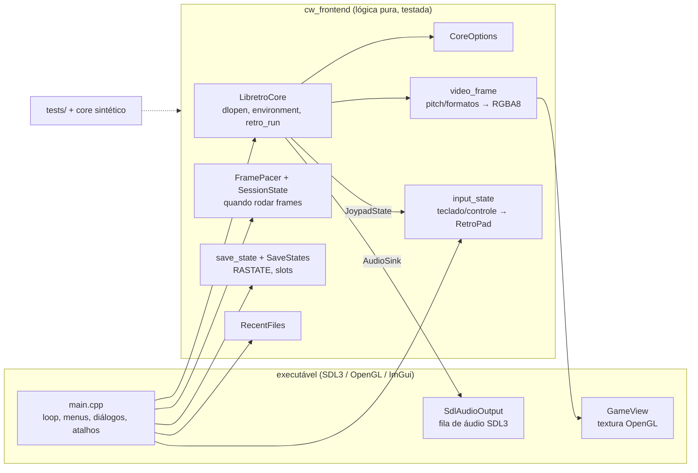

# 01 · Etapa 1: front-end mínimo

Objetivo da etapa: o Twilight Syndrome rodando na ferramenta (core libretro, vídeo, áudio, input,
save states e controles da sessão).

## Resumo da etapa

### O que a etapa entregou

A ferramenta abre um core libretro e um jogo pela linha de comando ou pelos menus, mantém uma lista
de recentes, roda e pausa a emulação, avança um frame por vez, reseta o jogo e salva/carrega estados.
O vídeo e o áudio passam pelo front-end SDL3; a janela de Status mostra o estado da sessão e a
sincronia. Nenhum core, BIOS ou jogo é distribuído pelo projeto.

### Mapa do código

Tudo fica em `src/frontend/`. As caixas da esquerda falam com o SDL/OpenGL (só no executável); as
da direita são lógica pura na biblioteca `cw_frontend`, testada sem janela, sem som e sem ROM.



### O caminho de um frame

Uma volta do loop principal (`main.cpp`), em ordem:

1. **Eventos SDL:** fechar janela, controle conectado/desconectado, perda de foco (solta todos os
   botões). O resultado de um diálogo de arquivo chega por uma fila com mutex: o callback roda em
   outra thread e nunca toca no core.
2. **Input:** o estado *atual* do teclado e dos controles vira uma máscara de 16 botões do RetroPad
   (`JoypadState`). Lido a cada volta, não por eventos: nenhum botão fica preso.
3. **Atalhos:** P, N, Ctrl+R, Shift+F1–F4 / F1–F4 (com Shift e Ctrl fora do input do jogo).
4. **Quantos frames rodar:** a fila de áudio é lida uma vez; pausado = 0, avanço = exatamente 1,
   rodando = o `FramePacer` decide pela fila de áudio (ou pelo relógio, sem áudio).
5. **`retro_run()` no core**, e lá dentro o core chama de volta:
   - `input_state` → responde com a máscara do passo 2;
   - `video_refresh` → `convert_to_rgba` respeitando o pitch; `NULL` = repetir o frame anterior;
   - `audio_sample_batch` → amostras acumuladas e entregues ao `AudioSink` no fim do frame.
6. **Imagem:** se chegou frame novo (o `serial` mudou), o `GameView` envia para a textura e a
   desenha com a proporção certa no centro do dock, atrás das janelas.
7. **Interface:** menus, janela Status, avisos ("Saved slot 1", "Paused"); `SDL_GL_SwapWindow`
   mostra tudo.

### Conceitos mais importantes

- [O contrato libretro: ordem das chamadas e environment callback (1.2)](#12--carregar-o-core-libretro)
- [Testar sem ROM: core sintético, ASan e teste de mutação (1.2b)](#12b--core-de-teste-sintético)
- [Pitch, formatos de pixel e frames duplicados (1.3)](#13--vídeo)
- [O áudio como relógio da emulação (1.4)](#14--áudio-e-ritmo-dos-frames)
- [Input por estado (polling) e conflitos com a interface (1.5)](#15--input-de-teclado-e-controle)
- [Nunca confiar em tamanhos vindos de arquivo; escrita atômica (1.6)](#16--save-states)
- [Callbacks em outra thread: só passar dados adiante (1.7)](#17--menus-e-controles-da-sessão)

### Lições das revisões

Os bugs que os testes, os sanitizadores e as revisões cruzadas (Claude ⇄ Codex) pegaram antes de
chegar até você:

| Onde | O bug | Quem pegou | A lição |
|---|---|---|---|
| 1.1 | `SCPH1001.BIN` escapava do `.gitignore` (padrões diferenciam maiúsculas) | Claude, antes do 1º commit | confira com `git status` / `git check-ignore -v` |
| 1.1 | Sem `HOME`, gravava configuração na pasta atual | Codex | nunca escrever onde o programa foi aberto |
| 1.2 | Operador vírgula num `if` passava sempre | Claude, ao reler | escreva condições em passos |
| 1.3 (#26) | `largura × altura × 4` dava a volta no `size_t` → escrita fora do buffer | Codex | limite as entradas *antes* da conta |
| 1.4 (#27) | "O jogo está 3% lento" — era ruído da medição de 1 s | Claude, medindo de novo | meça direito antes de concluir |
| 1.5 (#28) | Teclado do jogo morria após clicar numa janela (navegação do ImGui) | Claude, lendo o ImGui | teste de unidade não substitui usar o programa |
| 1.6 (#29) | Shift+F1 (salvar) também apertava Select | Codex | atalhos e controles do jogo competem pelo teclado |
| 1.6 (#29) | `RASTATE` cortado lido como state "cru"; quirks prometidas sem garantia | Codex | prometa só o que você consegue cumprir |
| 1.7 (#30) | Ctrl+R (reset) também apertaria R2 | Codex, sozinho | idem 1.6 |

Também valeu: **teste de mutação** (quebrar o código de propósito e ver o teste falhar) mostrou em
todas as subetapas que os testes realmente testavam; e **discordar de uma revisão com motivo**
(PR #29, `WantTextInput`) é tão importante quanto aceitar.

### Números da etapa

9 subetapas (1.1–1.7 + 1.2b): 1.1–1.2b revisadas nos arquivos, antes do GitHub, e 1.3–1.7 em
5 PRs com revisão cruzada (#26–#30); 49 casos de teste / 2845 verificações, todos sem
ROM; build sem nenhum warning e limpo no AddressSanitizer, UBSan e LeakSanitizer.

### Prova da etapa

1. Como um caminho escolhido no diálogo sai de uma thread SDL e chega ao core sem uma callback tocar
   no ImGui?
2. Por que o avanço de frame é um modo da sessão e por que o pacer continua marcado como pausado?
3. Em que ponto o áudio do frame avançado é descartado?
4. Como um slot é associado ao jogo e ao core corretos?
5. Por que o histórico é configuração XDG, enquanto os save states ficam no diretório de dados?
6. Que partes do caminho de um frame são testadas pelo core sintético e quais exigem o teste manual
   com o Beetle PSX?
7. Siga um aperto do botão ✕ (tecla Z) do teclado até o jogo: por quais arquivos e funções ele passa?
8. Três lugares desta etapa validam um tamanho vindo de fora antes de usá-lo. Quais são, e o que
   aconteceria sem cada validação?
9. Por que o áudio, e não o vsync do monitor, decide a velocidade do jogo?

| Subetapa | Conteúdo | Status |
|---|---|---|
| 1.1 | Esqueleto: git, submódulos, CMake, janela SDL3 + ImGui | ✅ |
| 1.2 | Carregar o core libretro | ✅ |
| 1.2b | Core de teste sintético (testes sem ROM) | ✅ |
| 1.3 | Vídeo | ✅ |
| 1.4 | Áudio e sincronia | ✅ |
| 1.5 | Input | ✅ |
| 1.6 | Save states | ✅ |
| 1.7 | Menu, abrir arquivos, pausar, avançar frame | ✅ |

---

## 1.1 · Esqueleto do projeto

### O que foi feito

- `git init` e 4 submódulos em `third_party/`, cada um fixado numa versão:
  imgui `v1.93.0-docking`, rcheevos `v12.5.0`, doctest `v2.5.3`, libretro-common (commit atual).
- Build com CMake em três alvos: `cheevo-workbench` (executável), `cw_devtools` (biblioteca, vazia
  por enquanto) e `cw_tests` (testes).
- Uma janela SDL3 com OpenGL 3.3 e Dear ImGui: menu (File → Quit, View → demo), janela "Status",
  docking ligado. O layout das janelas é salvo em `~/.config/cheevo-workbench/imgui.ini`.
- Dois testes que confirmam que o rcheevos compila e interpreta lógica.

### Conceitos

**Submódulo git.** Um repositório dentro do outro, fixado num commit exato. Quem clona usa
`git clone --recursive` (ou `git submodule update --init`). Vantagem: todo mundo compila com a
*mesma* versão do rcheevos, sem depender do que a distro instalou.

**CMake: alvos (targets).** Cada `add_library` / `add_executable` cria um alvo. Alvos se ligam com
`target_link_libraries`, e cada ligação tem uma visibilidade:

| Palavra | Significado |
|---|---|
| `PRIVATE` | Só este alvo usa (ex.: o executável usa `imgui`) |
| `PUBLIC` | Este alvo usa **e** quem depender dele também herda |
| `INTERFACE` | Este alvo não usa, só repassa (bibliotecas só de headers, como `doctest`) |

Exemplo real: `rcheevos` liga `libretro_api` como `PUBLIC` porque o header `rc_libretro.h` inclui
`libretro.h`. Quem incluir `rc_libretro.h` também precisa achar `libretro.h`.

**`SYSTEM` nos includes.** Marca os headers de terceiros como "do sistema": o compilador não mostra
warnings deles. Assim `-Wall -Wextra` só reclama do **nosso** código.

**`cw_warnings`.** Um alvo `INTERFACE` que só carrega as flags de warning. Ligamos ele apenas nos
nossos alvos, e o código de terceiros compila com as configurações dele.

**XDG Base Directory.** Padrão do Linux para onde guardar arquivos do usuário:
`$XDG_CONFIG_HOME` (padrão `~/.config`) para configuração, `$XDG_DATA_HOME` (`~/.local/share`)
para dados. Nunca escrever na pasta onde o programa foi executado.

**SDL3 + contexto OpenGL.** O SDL cria a janela e um *contexto* OpenGL (o "estado" da GPU ligado
àquela janela). Pedimos OpenGL 3.3 *core*, que funciona em qualquer driver de Linux e é o que cores
com renderização por hardware podem pedir depois.

**Dear ImGui é "immediate mode".** A interface é redesenhada **todo frame** a partir do zero: não
existem objetos "botão" guardados. `if (ImGui::Button("X")) { ... }` desenha o botão *e* diz se ele
foi clicado neste frame. O estado (ex.: janela aberta ou não) fica no nosso código (`UiState`).

**O loop principal** (`main.cpp`), que se repete a cada frame:

1. `SDL_PollEvent`: lê teclado, mouse, fechar janela; repassa ao ImGui.
2. `ImGui::NewFrame()`: começa a interface do frame.
3. Desenha menu e janelas.
4. `ImGui::Render()` + `glClear` + `ImGui_ImplOpenGL3_RenderDrawData`: desenha na GPU.
5. `SDL_GL_SwapWindow`: mostra o frame pronto (vsync limita a ~60 fps).

Nos próximos passos o `retro_run()` do core entra nesse loop, uma vez por frame.

**Docking com `PassthruCentralNode`.** As janelas de dev podem ser encaixadas nas bordas; o centro
fica "vazado" para a imagem do jogo aparecer por baixo (passo 1.3). O multi-janela (janelas fora da
principal) ficou desligado porque funciona mal no Wayland.

**doctest.** Framework de testes num único header. `TEST_CASE("nome") { CHECK(expr); }`. O
`test_main.cpp` só gera o `main()`; `ctest` roda tudo.

### Arquivos para ler (nesta ordem)

1. `CMakeLists.txt`: configuração geral (C++20, warnings, subpastas).
2. `cmake/ThirdParty.cmake`: como cada dependência vira um alvo.
3. `src/frontend/main.cpp`: a janela e o loop.
4. `src/frontend/paths.cpp`: a pasta de configuração XDG.
5. `tests/test_rcheevos.cpp`: os testes.
6. Para comparar: `third_party/imgui/examples/example_sdl3_opengl3/main.cpp` (o exemplo oficial em
   que o nosso `main.cpp` se baseou).

### O que aprendemos com a referência

- O exemplo oficial do ImGui foi a base da janela. Removemos o multi-janela (Wayland) e o código de
  outras plataformas (macOS, Emscripten, OpenGL ES).
- O RALibretro compila só uma parte do rcheevos (`reference/RALibretro/Makefile`): o hash do jogo,
  o `rc_libretro` (mapa de memória) e as informações de console. Avaliar conquistas fica a cargo da
  DLL do RAIntegration, mais um exemplo da divisão emulador × ferramentas de dev.
- Nós compilamos também o runtime (avaliação de lógica, Rich Presence, leaderboards), porque aqui
  o front-end e as ferramentas de dev são o mesmo programa. Deixamos de fora `rapi/` e
  `rc_client*`, as partes que falam com o servidor: assim a regra 1 é garantida no próprio build.

### Problemas encontrados

- **`libretro.h: No such file or directory`** ao compilar `rc_libretro.c`. Causa: o rcheevos
  precisa do header do libretro e não sabia onde achar. Solução: `target_link_libraries(rcheevos
  PUBLIC libretro_api)`.
- **Pastas diferentes no rcheevos.** O `master` (em `reference/`) foi reorganizado depois da
  v12.5.0: `src/runtime/rc_trigger.c` no master é `src/rcheevos/trigger.c` na v12.5.0. Lição:
  sempre estudar a versão que você realmente compila.
- **BIOS quase entrou no git.** O `.gitignore` tinha `*.bin` e `scph*`, mas padrões do
  `.gitignore` **diferenciam maiúsculas** no Linux: `SCPH1001.BIN` escapava dos dois. Solução:
  ignorar a pasta `.utils/` inteira e acrescentar `*.BIN`, `SCPH*` etc. O hook
  `.claude/hooks/guard-bash.sh` também foi reforçado: antes, só bloqueava `git add` que *citasse*
  o arquivo; agora confere o que `git add .` / `git commit -a` realmente pegariam
  (`git ls-files --others --exclude-standard`). Lição: confira com `git status` antes do primeiro
  commit, e `git check-ignore -v <arquivo>` mostra qual regra ignora (ou não) um arquivo.

### Para fixar

1. Qual a diferença entre `PUBLIC` e `PRIVATE` em `target_link_libraries`? Por que `rcheevos` →
   `libretro_api` é `PUBLIC`?
2. O que aconteceria se `cw_warnings` fosse ligado no alvo `imgui`?
3. Em ImGui, por que `if (ImGui::MenuItem("Quit"))` funciona sem guardar nenhum objeto "menu"?
4. Onde fica o `imgui.ini` se você rodar `XDG_CONFIG_HOME=/tmp/teste ./build/src/frontend/cheevo-workbench`?
   E se `XDG_CONFIG_HOME=pasta-relativa`? (dica: `xdg_base_dir` em `paths.cpp`)
5. Exercício: acrescente na janela "Status" uma linha com o tamanho da janela
   (`ImGui::GetIO().DisplaySize`). Compile e veja funcionar.

---

## 1.2 · Carregar o core libretro

### O que foi feito

- Classe `cw::LibretroCore` (`src/frontend/libretro_core.*`): abre o `.so` do core, liga as
  funções `retro_*`, responde às chamadas de *environment*, carrega o jogo e roda um frame por
  vez.
- Classe `cw::CoreOptions` (`src/frontend/core_options.*`): guarda as opções que o core declara
  (ex.: região da BIOS, renderizador) e devolve o valor atual quando o core pergunta.
- Linha de comando (provisória, até o menu do passo 1.7):
  ```sh
  ./build/src/frontend/cheevo-workbench \
      --core /usr/lib/libretro/mednafen_psx_libretro.so \
      --system ".utils/ps1-bios-pacote/ps1 bios" \
      ".utils/Twilight Syndrome - Tansaku-hen (Japan)/Twilight Syndrome - Tansaku-hen (Japan).cue"
  ```
- A janela "Status" mostra core, versão, resolução, fps do core e frames rodados.
- Resultado: o Beetle PSX achou a `scph5500.bin` (BIOS japonesa), carregou o jogo e rodou
  ~60 frames por segundo. Ainda sem imagem, som ou controle (passos 1.3 a 1.5).

### Conceitos

**Um core libretro é uma biblioteca dinâmica (`.so`).** Não é um programa: não tem `main()`. Ele
exporta funções com nomes fixos (`retro_init`, `retro_run`, …) e quem o usa (o *front-end*, nós)
as chama. Abrimos o arquivo em tempo de execução:

- `dlopen(caminho, RTLD_NOW | RTLD_LOCAL)` abre o `.so`. `RTLD_LOCAL` impede que os símbolos
  do core "vazem" e colidam com os de outro core.
- `dlsym(handle, "retro_run")` devolve o endereço da função (como `void*`), que convertemos para
  o tipo certo. O `decltype(&retro_run)` em `Api` pega o tipo exato direto do `libretro.h`.
- `dlclose(handle)` fecha.

**A ordem das chamadas importa** (está no `libretro.h`):

1. `retro_set_environment(cb)`: **antes** do `retro_init`, porque o core já pergunta coisas
   (pasta da BIOS, interface de log) enquanto inicializa.
2. `retro_init()`
3. `retro_set_video_refresh`, `..._audio_sample(_batch)`, `..._input_poll`, `..._input_state`:
   precisam estar definidos antes do primeiro `retro_run`.
4. `retro_load_game(&info)` e depois `retro_get_system_av_info` (resolução, fps, taxa do áudio).
5. A cada frame: `retro_run()`.
6. Para sair: `retro_unload_game()` → `retro_deinit()` → `dlclose()`.

**Environment callback = o core fazendo perguntas ao front-end.** Uma única função recebe um
número de comando (`cmd`) e um ponteiro `data` cujo tipo depende do comando. Exemplos:

| Comando | O core quer… | Respondemos |
|---|---|---|
| `GET_SYSTEM_DIRECTORY` | a pasta da BIOS | o `--system` |
| `GET_SAVE_DIRECTORY` | onde gravar memory cards | `~/.local/share/cheevo-workbench/saves` |
| `GET_LOG_INTERFACE` | uma função para imprimir log | `on_log` (vira `SDL_Log`) |
| `SET_PIXEL_FORMAT` | avisar o formato dos pixels | guardamos (Beetle PSX usa XRGB8888) |
| `SET_CORE_OPTIONS_V2` | declarar suas opções | `CoreOptions` guarda chaves e padrões |
| `GET_VARIABLE` | o valor atual de uma opção | `CoreOptions::get` |

Responder `false` significa "não suporto": o core se adapta (ex.: sem `SET_HW_RENDER`, usa
renderização por software). Por isso é seguro começar com poucos comandos.

**Por que o `s_active` estático?** As funções que passamos ao core são ponteiros de função C
puros, sem um argumento "contexto". Uma função de C não consegue chamar um método de um objeto
C++ sem saber *qual* objeto. Então guardamos um ponteiro estático para o core ativo, e as funções
`on_*` (estáticas) repassam a chamada para ele. Consequência: só um core por vez, o que é o normal
num emulador.

**`need_fullpath`.** Cores de CD (como o de PS1) leem os arquivos sozinhos e só querem o caminho.
Cores de cartucho geralmente pedem o arquivo inteiro na memória; nesse caso lemos o arquivo para
`game_data_` e o mantemos vivo enquanto o jogo roda.

**Funções variádicas (`on_log`).** O log do core funciona como `printf` (`fmt, ...`). Usamos
`va_list` + `vsnprintf` para montar o texto e repassar ao `SDL_Log`. Dica: para ver também as
mensagens de debug, rode com `SDL_LOGGING="app=debug"`.

### Arquivos para ler (nesta ordem)

1. `src/frontend/libretro_core.hpp`: a interface da classe e os comentários.
2. `src/frontend/libretro_core.cpp`: `load`, `load_game`, `unload`, depois `environment`.
3. `src/frontend/core_options.cpp`: os três formatos de opções.
4. `src/frontend/main.cpp`: `parse_args`, `load_from_options` e o `core.run_frame()` no loop.
5. Referência: no `third_party/libretro-common/include/libretro.h`, procure por
   `RETRO_ENVIRONMENT_GET_SYSTEM_DIRECTORY` e leia o comentário; repita para mais 2 ou 3 comandos.

### O que aprendemos com a referência

Lemos `reference/RALibretro/src/libretro/Core.cpp`:

- A ordem é a mesma: `set_environment` → `init` → `load_game` → callbacks de A/V. Eles definem os
  callbacks de vídeo/áudio só depois do `load_game`; nós logo depois do `init`, o que também é
  válido (só precisam existir antes do primeiro `retro_run`).
- Eles também logam cada comando não suportado **uma vez só**, para não inundar o log; fizemos o
  mesmo com `reported_unsupported_`.
- O RALibretro implementa ~50 comandos (VFS, disco, microfone, rumble…). Nós começamos com o
  mínimo e acrescentamos conforme a necessidade aparecer.

Comandos que o Beetle PSX pediu e ainda **não** tratamos (aparecem com `SDL_LOGGING=app=debug`),
e onde entram:

| Comando | Para quê | Passo |
|---|---|---|
| `SET_MEMORY_MAPS` | descreve a memória do console; essencial para as conquistas | 2.1 |
| `GET_INPUT_BITMASKS` | ler todos os botões de uma vez | 1.5 |
| `SET_SERIALIZATION_QUIRKS` | detalhes de save state | 1.6 |
| `GET_RUMBLE_INTERFACE` | vibração do controle | opcional |
| `SET_DISK_CONTROL_INTERFACE` | trocar de disco (jogos com vários CDs) | opcional |
| `GET_LANGUAGE`, `GET_VFS_INTERFACE`, `GET_LED_INTERFACE`, `GET_PERF_INTERFACE` | extras | opcional |

### Problemas encontrados

- **Caminho relativo da BIOS.** Passar `--system .utils/...` funcionava, mas o core recebia um
  caminho relativo, o que quebra se algo mudar a pasta atual. Agora convertemos com
  `std::filesystem::absolute`.
- **`pkill -f` matou o próprio shell** durante os testes: o padrão procurado aparecia na linha de
  comando do próprio `pkill`. Lição: para achar processos, `ps -eo pid,args | grep '[n]ome'` (o
  `[n]` impede o grep de achar a si mesmo).
- **Sem `HOME`, o app gravava na pasta atual** (achado na revisão do Codex). O `paths.cpp` do 1.1
  caía em `current_path()` quando não havia `XDG_*` nem `HOME`. Agora `config_dir()`/`data_dir()`
  devolvem um caminho **vazio** nesse caso: o layout do ImGui não é salvo e o core recebe `NULL`
  como pasta (o `libretro.h` permite: "no directory defined"). Junto veio outra correção:
  `std::filesystem::create_directories(dir)` sem `error_code` **lança exceção** se falhar; a versão
  com `std::error_code ec` só preenche `ec`.
- **Bug na correção (pego antes de compilar):** a primeira versão usava
  `if (!data.empty() && create_directories(...), !ec)`. O operador vírgula tem a menor precedência
  de todas: aquilo é `(A && B), !ec`, então o `if` passava mesmo com `data` vazio. Lição: evite o
  operador vírgula em condições; escreva em passos.

### Para fixar

1. Por que `retro_set_environment` precisa vir antes de `retro_init`?
2. O que acontece se o environment callback responder `false` para `SET_HW_RENDER`?
3. Por que não dá para passar um método de classe C++ direto como callback do libretro?
4. O que `need_fullpath = true` diz ao front-end? Qual o valor no Beetle PSX, e por quê?
5. Exercício: rode com `SDL_LOGGING="app=debug"` e veja a lista de comandos não suportados.
   Escolha um (ex.: `GET_LANGUAGE`), leia o comentário dele no `libretro.h` e diga o que você
   responderia.

---

## 1.2b · Core de teste sintético

### O que foi feito

- Extraímos `core_options.cpp`, `libretro_core.cpp` e `paths.cpp` para a biblioteca estática
  `cw_frontend`. O executável e `cw_tests` ligam nela; as classes continuam com o mesmo
  comportamento.
- Criamos `cw_test_core`, um módulo C pequeno em `tests/test_core/test_core.c`, que implementa a
  ABI libretro e não depende de ROM ou BIOS. O arquivo de conteúdo sintético dos testes é criado
  na pasta temporária do sistema e removido ao final de cada caso.
- O core oferece uma opção de formato de pixel, anuncia-a pela API v2 e usa `SET_VARIABLES` se o
  front-end informar uma versão de opções abaixo de 2. Ao carregar conteúdo, lê o valor com
  `GET_VARIABLE` e negocia 0RGB1555, XRGB8888 ou RGB565.
- Cada quadro de vídeo tem 64×32 pixels, linhas com 16 bytes de padding e valores determinísticos
  a partir de x, y e do contador de quadros. Consulta `GET_CAN_DUPE` e, quando o front-end permite,
  envia `NULL` a cada quarto quadro para repetir o anterior. Emite 735 quadros de áudio estéreo por
  chamada de `retro_run`.
- O core consulta os 16 botões de `RETRO_DEVICE_JOYPAD` na porta 0 depois de chamar
  `input_poll`. Os 64 KiB de `RETRO_MEMORY_SYSTEM_RAM` guardam o contador em little-endian nos
  bytes 0–3 e a última máscara de 16 bits nos bytes 4–5, também em little-endian (bit *i* indica
  o botão *i*).
- Save state tem tamanho fixo de 65.544 bytes: contador de quadros de 64 bits em little-endian,
  seguido pelos 64 KiB de RAM. `retro_unserialize` rejeita qualquer tamanho diferente.
- Os testes carregam o módulo pelo caminho produzido por CMake, verificam metadados, opção,
  dimensões e contagem de quadros; também cobrem biblioteca ausente, biblioteca que não é core,
  tentativa de carregar conteúdo sem core e unload/reload.

### Conceitos

**Core de teste como `.so`.** `cw_test_core` é compilado como `MODULE`, portanto exporta as funções
`retro_*` que `LibretroCore` procura com `dlsym`. O alvo não é instalado nem distribuído como
emulador; ele existe só para os testes automatizados.

**A biblioteca estática facilita testar o front-end.** Antes, os arquivos do host eram compilados
direto no executável, então os testes não podiam instanciar `cw::LibretroCore`. `cw_frontend`
compartilha a implementação entre o executável e `cw_tests`, sem duplicar fontes nem mudar o
comportamento do host.

**Opções têm versões.** O core pergunta `GET_CORE_OPTIONS_VERSION`; se a resposta for pelo menos 2,
registra a opção com `SET_CORE_OPTIONS_V2`. Caso contrário, usa a lista antiga de
`SET_VARIABLES`. Na hora de carregar o conteúdo, `GET_VARIABLE` devolve a escolha atual e o core
passa o enum correspondente a `SET_PIXEL_FORMAT`.

**Pitch é o tamanho da linha em bytes.** Aqui ele é maior do que `64 × bytes_por_pixel`, porque
cada linha tem 16 bytes que não são pixels. Um front-end que trate pitch como largura em pixels
vai deslocar as linhas. As amostras de áudio também têm uma unidade própria: 735 significa
735 pares estéreo (esquerda, direita), não 735 valores `int16_t` isolados.

**Um frame duplicado ainda conta.** `retro_run` é chamado uma vez por frame de emulação. O core
incrementa o contador mesmo quando envia `NULL` ao callback de vídeo para pedir que o front-end
repita a imagem anterior; áudio e input continuam sendo processados nesse frame.

**Save states precisam ser reprodutíveis.** O estado usa campos serializados explicitamente em
little-endian, sem depender de padding de uma `struct` C ou da arquitetura do compilador. Isso
permite verificar o tamanho e rejeitar buffers truncados ou com tamanho inesperado.

### Arquivos para ler (nesta ordem)

1. `src/frontend/CMakeLists.txt`: como `cw_frontend` compartilha o host entre app e testes.
2. `tests/CMakeLists.txt`: o módulo de teste, caminho no compile definition e ligação com
   `cw_frontend`.
3. `tests/test_core/test_core.c`: callbacks, opção, vídeo, áudio, input, RAM e serialização.
4. `tests/test_libretro_core.cpp`: testes da classe real do front-end com conteúdo temporário.
5. `src/frontend/libretro_core.hpp` e `src/frontend/libretro_core.cpp`: interface exercitada pelos
   testes.
6. `third_party/libretro-common/include/libretro.h`: procure os tipos e comandos citados abaixo.

### O que aprendemos com a referência

Não copiamos código de emuladores: o core sintético foi escrito do zero para ter comportamento
controlado e conteúdo não protegido. Conferimos os contratos diretamente no `libretro.h`:

- `retro_system_info`, `RETRO_API_VERSION` e `retro_game_info` definem identificação, versão da
  ABI e a passagem do conteúdo em memória quando `need_fullpath` é falso.
- `RETRO_ENVIRONMENT_GET_CORE_OPTIONS_VERSION`, `SET_CORE_OPTIONS_V2`, `SET_VARIABLES`,
  `GET_VARIABLE` e `SET_PIXEL_FORMAT` definem a opção e a negociação do formato.
- `RETRO_ENVIRONMENT_GET_CAN_DUPE`, `retro_video_refresh_t`, `retro_pixel_format` e o contrato de
  `retro_run` definem dimensões, pitch e `NULL` como duplicação de quadro.
- `retro_audio_sample_batch_t` define que `frames` conta pares de amostras estéreo.
- `retro_input_poll_t`, `retro_input_state_t`, `RETRO_DEVICE_JOYPAD` e os IDs até
  `RETRO_DEVICE_ID_JOYPAD_R3` definem a leitura dos 16 botões.
- `RETRO_MEMORY_SYSTEM_RAM`, `retro_get_memory_data` e `retro_get_memory_size` definem a região
  exposta pelo core.
- `retro_serialize_size`, `retro_serialize` e `retro_unserialize` definem o contrato de estado;
  o tamanho mínimo exigido pela API é respeitado, e este core escolhe exigir tamanho exato.
- `RETRO_ENVIRONMENT_GET_LOG_INTERFACE` fornece o callback usado para registrar inicialização e
  carregamento.

### Problemas encontrados

- O primeiro build apontou uma função auxiliar de leitura de 32 bits não usada. Ela foi removida;
  o build final foi refeito sem warnings.

### Para fixar

1. Por que `need_fullpath = false` faz o front-end passar `data` e `size` ao core?
2. Se uma linha tem 64 pixels de 16 bits e mais 16 bytes de padding, qual é o pitch em bytes?
3. O que o front-end deve fazer quando `retro_video_refresh` recebe `data == NULL`?
4. Por que o tamanho serializado é `8 + 65.536`, e por que não serializar a `struct` C diretamente?
5. Exercício: altere o core para emitir um quadro duplicado a cada terceiro frame e atualize um
   teste que verifique a contagem de quadros após uma duplicação.

---

## 1.3 · Vídeo

### O que foi feito

- **Conversão de pixels** (`src/frontend/video_frame.*`, na `cw_frontend`): cada frame do core é
  convertido para RGBA8 (4 bytes por pixel, linhas sem padding) a partir dos 3 formatos do
  libretro, respeitando o **pitch**.
- **`LibretroCore`** guarda o último frame (`video_frame()`), com um `serial` que só aumenta
  quando chega imagem nova. Frame duplicado (`data == NULL`) mantém imagem e serial.
  `SET_GEOMETRY` atualiza só largura, altura e proporção. `SET_HW_RENDER` agora é recusado
  explicitamente (com log), e o core cai para renderização por software.
- **`GameView`** (`src/frontend/game_view.*`, só no executável): envia o frame para uma textura
  OpenGL (só quando o serial muda) e desenha a imagem centralizada no nó central do dock, com a
  proporção do core e filtro *nearest* (pixels nítidos).
- **Core de teste** ganhou uma opção para mudar de resolução no frame 3 e passou a pedir
  renderização por hardware no `load_game` (para provar que recusamos).
- **Testes:** conversão com buffers montados à mão (cada formato, padding, entradas inválidas) e,
  com o core de teste, pixels esperados em cada formato, frame duplicado e mudança de geometria.
  13 casos / 224 verificações; limpos no ASan/UBSan.

### Conceitos

**Pitch × largura.** A largura é em *pixels*; o pitch é o tamanho da linha em *bytes* e pode ter
sobra no fim (padding). O endereço do pixel (x, y) é `data + y * pitch + x * bytes_por_pixel`.
Usar `y * largura * bytes_por_pixel` funciona até o dia em que um core manda padding, e aí a imagem
sai "entortada" em diagonal. (O teste de mutação mostrou isso: 6 testes falham.)

**Os três formatos do libretro** (valores de 16/32 bits na ordem nativa da máquina):

| Formato | Bits | Canal de 5 bits → 8 bits |
|---|---|---|
| 0RGB1555 | `0 RRRRR GGGGG BBBBB` (bit 15 ignorado) | `(v << 3) \| (v >> 2)` |
| RGB565 | `RRRRR GGGGGG BBBBB` (verde com 6 bits) | verde: `(v << 2) \| (v >> 4)` |
| XRGB8888 | `XXXXXXXX RRRRRRRR GGGGGGGG BBBBBBBB` | já é 8 bits |

Por que `(v << 3) | (v >> 2)` e não só `v << 3`? Com `v << 3`, o máximo (31) vira 248, e o branco
fica cinza-claro. Repetindo os bits de cima nos de baixo, 31 vira 255.

**Conversão na CPU × direto na GPU.** O RALibretro manda cada formato direto para o OpenGL
(`GL_UNSIGNED_SHORT_5_6_5`, `GL_UNPACK_ROW_LENGTH` para o pitch). É mais rápido, mas só dá para
testar com uma GPU. Nós convertemos para RGBA8 na CPU: um frame de PS1 (320×240) são ~77 mil
pixels, nada para a CPU a 60 fps, e a conversão vira uma função pura, testável sem janela.

**Frame duplicado ("dupe").** Respondemos `GET_CAN_DUPE = true`; então, quando nada mudou, o core
pode passar `NULL` em vez de reenviar a imagem. O `serial` deixa o `GameView` pular o envio para
a GPU nesses frames.

**Proporção (aspect ratio).** O core informa a proporção em que a imagem deve ser *mostrada*, que
pode ser diferente de largura/altura (pixels de console nem sempre são quadrados). Se for `<= 0`,
o `libretro.h` manda usar largura/altura. Desenhamos o maior retângulo com essa proporção que cabe
na área ("letterbox").

**Desenhar atrás das janelas.** `ImGui::GetBackgroundDrawList()` é desenhada antes de todas as
janelas do ImGui. A imagem vai lá, no retângulo do nó central do dock
(`DockBuilderGetCentralNode`, que fica em `imgui_internal.h`: API interna, pode mudar entre versões
do ImGui).

**Recursos OpenGL têm dono.** A textura só existe enquanto existe o contexto OpenGL. Por isso
`GameView::release()` é chamado *antes* de destruir o contexto; chamar `glDeleteTextures` sem
contexto é comportamento indefinido.

### Arquivos para ler (nesta ordem)

1. `src/frontend/video_frame.cpp`: a conversão (curta, vale ler linha a linha).
2. `tests/test_video_frame.cpp`: como os buffers com padding são montados.
3. `src/frontend/libretro_core.cpp`: `on_video_refresh`, `SET_GEOMETRY`, `SET_HW_RENDER`,
   `clear_frame`.
4. `src/frontend/game_view.cpp`: textura, envio e o cálculo do letterbox em `draw`.
5. `src/frontend/main.cpp`: onde `update` e `draw` entram no loop.
6. Referência: `reference/RALibretro/src/components/Video.cpp`, função `refresh` (o caminho
   "direto na GPU").

### O que aprendemos com a referência

- O RALibretro envia o formato nativo para a GPU e usa `GL_UNPACK_ROW_LENGTH` (em pixels) para o
  pitch; escolhemos converter na CPU pela testabilidade (ver acima).
- Ele cria a textura no tamanho **máximo** e desenha só a parte usada. Nós recriamos a textura
  quando a resolução muda, o que é mais simples; mudanças de resolução são raras.

### Problemas encontrados

- **Captura de tela no Wayland/GNOME:** ferramentas externas não conseguem capturar a janela, então
  a verificação visual é sua; os testes cobrem os pixels.
- **Serial reiniciando:** se o serial voltasse a 0 ao carregar outro jogo, o `GameView` podia achar
  que já tinha aquele frame e mostrar a imagem antiga. Por isso o serial nunca é zerado.
- **Teste de mutação:** os testes passaram de primeira, então introduzimos 3 bugs de propósito
  (ignorar o pitch, aceitar hardware rendering, dupe apagando a imagem). Cada um fez testes
  falharem: os testes realmente testam.
- **Overflow no tamanho do frame (achado na revisão do Codex, PR #26).** `width * height * 4`
  com `width = height = 2^31` dá 2^64, que num `size_t` de 64 bits **volta a zero**: o vetor fica
  vazio e o loop escreve fora dele. Nenhum core normal manda isso, mas um core com bug mandaria.
  Correção: rejeitar lados maiores que `kMaxFrameSide` (16384) **antes** de qualquer conta. Com a
  correção removida de propósito, o ASan acusa `heap-buffer-overflow` no teste novo: o bug era real.
  Junto veio outra proteção: `on_video_refresh` roda **dentro** do `retro_run()` do core, que é
  código C. Uma exceção C++ (ex.: `std::bad_alloc`) atravessando código C é comportamento
  indefinido, então ela é capturada ali.

### Para fixar

1. Um frame 0RGB1555 de 320 pixels de largura tem pitch 1024. Quantos bytes de padding há por linha?
2. Por que `expand5(31)` precisa dar 255, e quanto daria só com `v << 3`?
3. O que o `GameView` faz quando o core manda um frame duplicado? E por quê?
4. Se o core informar `aspect_ratio = 0` para um frame de 256×224, qual proporção desenhamos?
5. Exercício: na janela Status, mostre também o formato de pixel atual (dica:
   `core.pixel_format()`).
6. Por que verificamos `width > kMaxFrameSide` *antes* de calcular `width * height * 4`, e não depois?

---

## 1.4 · Áudio e ritmo dos frames

### O que foi feito

- `LibretroCore` agora recebe um `AudioSink` não dono. Os callbacks de amostra única e de lote
  juntam pares estéreo intercalados durante `retro_run()`; ao fim do frame, o core chama o sink uma
  vez com todo o áudio acumulado. O lote vazio também é entregue quando um frame não produz áudio.
- `SdlAudioOutput` abre o dispositivo padrão de reprodução com `SDL_OpenAudioDeviceStream`, PCM
  S16 estéreo e a taxa informada pelo core. O SDL converte para o dispositivo. Se
  `SET_SYSTEM_AV_INFO` mudar a taxa, o stream é reaberto. Falhas são registradas e aparecem na
  janela Status; sem stream, o loop usa o relógio e continua sem som.
- `FramePacer` é lógica pura, sem SDL. Com áudio, tenta manter cerca de 50 ms na fila e limita cada
  volta a três frames. Sem áudio, acumula tempo usando o FPS declarado pelo core. Após uma pausa de
  mais de 250 ms, descarta os frames vencidos para não criar uma rajada. A API de pausa retorna a
  transição para pausado; o chamador limpa a fila de áudio. Os controles de pausa continuam sendo
  parte do passo 1.7.
- A janela Status mostra dispositivo ou erro, áudio enfileirado em milissegundos, modo de ritmo e
  FPS medido a partir dos frames realmente executados. O vsync limita a apresentação enquanto a
  janela tem foco. Sem foco, o loop usa uma cadência de no máximo 120 Hz, enquanto o pacer
  determina quando o core roda. Minimizar mantém a emulação e o áudio ativos, sem apresentar
  frames; `P` continua sendo a pausa explícita.
- O core sintético agora testa áudio em lote e por amostra, a sequência estéreo determinística e a
  notificação de mudança da taxa de amostragem.

### Conceitos

**Amostras e frames de áudio.** No libretro, uma amostra é um valor de um canal; um *frame* de
áudio estéreo contém dois `int16_t` intercalados, esquerdo e direito. O callback em lote recebe a
quantidade de frames estéreo, não a quantidade total de valores. Por isso, 735 frames são 1470
 valores `int16_t`.

**Callbacks curtos, entrega em lote.** O core pode chamar o callback por amostra até 1470 vezes em
um `retro_run()`, ou fazer uma chamada em lote. O front-end guarda os pares num vetor e só chama o
sink ao final de `retro_run()`. Assim, o core não conhece SDL e o caminho por amostra não faz uma
chamada ao dispositivo a cada valor.

**`SDL_AudioStream` e reamostragem.** O formato de entrada da stream é o que o core produz
(S16, dois canais, taxa do core). O SDL converte para o formato e a taxa que o dispositivo suporta.
`SDL_GetAudioStreamQueued()` informa bytes ainda enfileirados no formato de entrada; dividimos pela
taxa de bytes por segundo para obter segundos de áudio pendente. Uma nova taxa em
`SET_SYSTEM_AV_INFO` exige uma stream com outro formato de entrada.

**Dois relógios possíveis.** Com dispositivo de áudio, a fila é o relógio: se cair abaixo de 50 ms,
o pacer agenda frames suficientes para preenchê-la, até o limite por volta. Sem áudio disponível,
`steady_clock` e o FPS do core formam um acumulador de tempo. O FPS medido é independente do FPS
declarado e conta frames executados por tempo real.

**Ressincronização.** Depois de uma pausa longa, tentar executar todos os frames perdidos criaria
uma sequência de chamadas rápidas ao core. O pacer zera o acumulador e retoma no próximo intervalo
normal. No modo de áudio, o tamanho máximo do lote e a fila limitada dão o mesmo limite à retomada.

### Arquivos para ler (nesta ordem)

1. `src/frontend/audio_sink.hpp`: contrato de áudio independente de SDL.
2. `src/frontend/libretro_core.cpp`: acúmulo dos callbacks e entrega no fim de `run_frame()`;
   atualização da taxa em `SET_SYSTEM_AV_INFO`.
3. `src/frontend/sdl_audio_output.cpp`: stream SDL3, reabertura e tratamento de falhas.
4. `src/frontend/frame_pacer.cpp`: decisões de ritmo e medição com tempo injetado.
5. `src/frontend/main.cpp`: integração no loop e linhas da janela Status.
6. `tests/test_libretro_core.cpp`, `tests/test_frame_pacer.cpp` e
   `tests/test_core/test_core.c`: sequência determinística, callbacks e simulações.
7. Referência: `reference/RALibretro/src/components/Audio.cpp` (somente comparação de desenho).
8. API: `third_party/libretro-common/include/libretro.h`, callbacks de áudio e
   `RETRO_ENVIRONMENT_SET_SYSTEM_AV_INFO`.

### O que aprendemos com a referência

- O `Audio.cpp` do RALibretro reamostra com Speex e escreve numa FIFO própria; se ela estiver cheia,
  o modo bloqueante espera e pode limpá-la após 250 ms. Aqui usamos a conversão e a fila do
  `SDL_AudioStream`, que aceitam lotes sem espera manual. O callback libretro fica desacoplado do
  backend SDL.
- A taxa não é fixa no front-end: o core informa o formato temporal inicial e pode atualizá-lo por
  `SET_SYSTEM_AV_INFO`. O sink recebe a taxa nova e reabre o dispositivo.

### Problemas encontrados

- **Limite do relógio simulado:** o primeiro teste de travada longa falhou por poucos nanossegundos
  quando `1/60` foi convertido para o relógio monotônico. O acumulador agora usa uma pequena margem
  numérica antes de truncar o número de frames devidos; os casos 60/50 FPS em 60/144 Hz passam.
- **Ambiente sem janela Wayland acessível:** a execução normal terminou com `No available video
  device`. Com `SDL_VIDEODRIVER=offscreen`, o app abriu, carregou o Beetle PSX e o jogo, e o log
  confirmou o fallback com `SDL_AUDIO_DRIVER=driver-inexistente`. O core continuou rodando sem
  áudio; medições de aproximadamente 59,8–61,0 FPS ficaram próximas dos 59,940 declarados. A
  janela Status não pôde ser inspecionada visualmente nesse backend offscreen.
- **Driver de áudio padrão do container:** a tentativa de inicialização imprimiu
  `pa_write() failed while trying to wake up the mainloop: Operation not permitted` e não chegou
  aos logs de carregamento do core em 12 segundos; encerrei o processo. O driver `dummy` e o nome
  inexistente retornam normalmente. O backend padrão não pôde ser validado neste sandbox.
  `SDL_InitSubSystem()` deve rodar na thread principal (`SDL3/SDL_init.h`),
  então não é seguro contornar esse bloqueio movendo a inicialização para uma thread em background.
- **Saída de áudio disponível para teste:** com `SDL_AUDIO_DRIVER=dummy`, o log confirmou o stream
  estéreo a 44100 Hz e o pacer mediu entre 58,6 e 61,0 FPS, em torno de 59,7 após o início.

### Na revisão (Claude, no seu Arch com áudio de verdade)

- **O áudio real funciona.** No ambiente do Codex a inicialização do PipeWire travava (sem acesso
  ao servidor de áudio). No seu Arch, o SDL abriu "Ryzen HD Audio Controller Analog Stereo" a
  44100 Hz normalmente; o SDL reamostra para os 48000 Hz do PipeWire.
- **Medir certo antes de concluir.** O "FPS medido" da janela Status oscilou entre 56,5 e 61,4 e
  pareceu indicar o jogo 3% lento. Mas cada leitura cobre só ~1 s, e o pacer roda até 3 frames por
  vez: isso dá um erro de ±3 fps por leitura. Medindo do jeito certo (duas execuções, 8 s e 28 s, e
  dividindo a *diferença* de frames pela *diferença* de tempo, o que cancela a inicialização), a
  velocidade real foi **59,75 fps para 59,94 pedidos (−0,3%)**, dentro do erro da própria medição.
  Lição: uma janela curta de medição pode mostrar um problema que não existe.

### Correção posterior: áudio ao trocar de janela

O relato de som lento e chiado ao ir para o terminal revelou uma dependência do loop:
`SDL_GL_SwapWindow()` roda na mesma thread que `retro_run()`. Se a apresentação de uma janela
encoberta esperar demais, o core deixa de produzir áudio a tempo. A fila alvo é de apenas 50 ms,
e executar até três frames por volta não compensa um loop que cai para cinco voltas por segundo.
Nesse exemplo, o teto seria 15 frames emulados por segundo; cinco voltas é uma ilustração,
não uma medição do problema relatado. O dispositivo continua consumindo amostras enquanto a
thread espera, causando **audio underrun** quando a fila esvazia: faltam amostras para reproduzir.

Agora a perda de foco solicita `SDL_GL_SetSwapInterval(0)` e limita o loop a 120 Hz pelo relógio,
com `SDL_DelayNS()` no tempo restante de cada iteração. Isso limita o trabalho da interface;
o FPS do core continua controlado pelo `FramePacer`, que usa a fila de áudio ou o relógio.
Ao recuperar o foco, restaura `SDL_GL_SetSwapInterval(1)`. Se o driver recusar intervalo zero,
a apresentação em segundo plano fica suspensa até confirmar a configuração, com nova tentativa
a cada segundo.
Isso também cobre o estado desconhecido após uma falha na configuração inicial do vsync.
A antiga saída antecipada ao minimizar foi removida, pois interrompia a produção de áudio.

Um teste temporário instrumentou o loop real com o core sintético e áudio SDL `dummy`, usando
estados de foco/minimização injetados e uma janela de cobertura real. Sem foco, mediu 61,1 FPS;
minimizado, 60,0 FPS. Após 750 ms de estabilização por fase, a fila não esvaziou e seu mínimo
ficou próximo de 27 ms. A pausa explícita executou zero frames, e a retomada voltou ao ritmo
normal. Isso verifica o agendamento; o backend `dummy` não valida o som no dispositivo real.

Uma segunda execução injetou falhas na configuração inicial do vsync e na primeira solicitação
de intervalo zero. O fallback manteve cerca de 60 FPS sem foco e minimizado, sem esvaziar a fila
após a estabilização. Os 142 testes existentes também passaram, incluindo a execução com
AddressSanitizer e UndefinedBehaviorSanitizer (sem LeakSanitizer nesse ambiente).

**Validação manual:** depois de testar a versão corrigida no seu ambiente, o usuário confirmou
que o problema foi resolvido. A espera da apresentação não deve determinar o ritmo da emulação
quando a janela está em segundo plano; a pausa continua sendo uma ação explícita com `P`.

### Para fixar

1. Em `retro_audio_sample_batch_t`, por que `frames == 735` representa 1470 valores `int16_t`?
2. Por que `AudioSink::write()` acontece uma vez depois de `retro_run()` em vez de dentro de cada
   callback libretro?
3. Como o SDL sabe a taxa de entrada do core e por que é preciso reabrir a stream após
   `SET_SYSTEM_AV_INFO`?
4. O que acontece com o ritmo quando a abertura do dispositivo falha? Qual valor a janela Status
   mostra para o modo de pacing?
5. Por que o pacer descarta frames vencidos depois de uma travada longa em vez de tentar alcançá-los?
6. Exercício: ligue `cw_test_audio_mode=single` e compare o vetor capturado ao caminho em lote.

## 1.5 · Input de teclado e controle

### O que foi feito

- `JoypadState` combina por OR as máscaras de 16 botões de fontes independentes. Remover uma
  fonte libera só aquele controle; perder o foco limpa todas as fontes.
- Funções puras traduzem o snapshot de teclas SDL e o snapshot de botões/eixos SDL Gamepad para o
  layout libretro. O loop lê o estado atual a cada volta, sem manter estado próprio baseado em
  eventos de tecla.
- O core recebe `RETRO_DEVICE_JOYPAD` na porta 0 e o front-end confirma suporte a
  `GET_INPUT_BITMASKS`. O core sintético testa cada ligação no modo de consulta individual e no
  modo de máscara, lendo os bits guardados na RAM sintética.
- Controles são enumerados ao iniciar, abertos ao conectar e fechados ao desconectar. O estado de
  teclado não chega ao core enquanto a janela não está focada ou o ImGui captura o teclado. A
  janela Status lista controles e botões ativos.

### Conceitos

**RetroPad e máscara.** `RETRO_DEVICE_ID_JOYPAD_B` até `R3` são IDs 0–15. Uma consulta normal
retorna 0 ou 1 para um ID. Se o front-end responde `true` a
`RETRO_ENVIRONMENT_GET_INPUT_BITMASKS`, o core pode consultar `RETRO_DEVICE_ID_JOYPAD_MASK` e
recebe todos os 16 estados nos bits correspondentes. O callback retorna `int16_t`, então o bit
R3 (bit 15) ocupa o bit alto mesmo que a representação apareça como número negativo. O parâmetro
de dados de `GET_INPUT_BITMASKS` é ignorado; o core sintético verifica a capacidade pelo valor
booleano retornado pelo callback e passa `NULL` como dado.

**Fontes e OR.** Teclado e cada controle têm IDs próprios e contribuem com uma máscara. A união
por OR permite, por exemplo, segurar Start no teclado enquanto o direcional vem do controle. A
remoção do dispositivo apaga sua fonte sem soltar as outras; perda de foco apaga todas.

**Estado atual, não bordas.** `SDL_GetKeyboardState`, `SDL_GetGamepadButton` e
`SDL_GetGamepadAxis` consultados após processar eventos refletem o estado corrente. Isso evita
guardar uma tecla como pressionada quando algum caminho de liberação não é recebido. Eventos de
teclado não atualizam o estado do jogo; eventos de conexão/desconexão e foco controlam o ciclo de
vida das fontes.

**Layout físico padronizado.** SDL nomeia os quatro botões frontais pela posição: `SOUTH`, `EAST`,
`WEST`, `NORTH`. Eles mapeiam para libretro B, A, Y, X, respectivamente, igual ao padrão do
RetroArch; num controle PlayStation isso corresponde a Cross, Circle, Square e Triangle.
Gatilhos SDL vão de 0 a 32767; L2/R2 ativam acima de aproximadamente metade do curso.

**Captura do ImGui.** `WantCaptureKeyboard` indica que o teclado deve atender a interface (por
exemplo, um campo de texto). O controle continua sendo lido enquanto o ImGui captura o teclado.
Com a janela sem foco, nenhuma fonte envia botões.

### Arquivos para ler (nesta ordem)

1. `src/frontend/input_state.hpp` e `src/frontend/input_state.cpp`: contratos, tabela padrão e
   lógica pura de combinação/mapeamento.
2. `src/frontend/libretro_core.hpp` e `src/frontend/libretro_core.cpp`: ponteiro não dono,
   callback de input, negociação de bitmask e acessor de RAM usado pelos testes.
3. `src/frontend/main.cpp`: enumeração e hot-plug SDL, leitura por volta, captura do teclado e
   Status.
4. `tests/test_input_state.cpp` e `tests/test_libretro_core.cpp`: mapeamentos unitários, fontes e
   observação dos bits pelo core sintético nos dois modos.
5. `tests/test_core/test_core.c`: opção de consulta individual/máscara e gravação do input nos
   offsets 4–5 da RAM.
6. API: `third_party/libretro-common/include/libretro.h`, definições de joypad IDs, máscara e
   `GET_INPUT_BITMASKS`.
7. Referência: `reference/RALibretro/src/components/Input.cpp` (somente comparação de desenho;
   nenhum código foi copiado).

### O que aprendemos com a referência

- `Input.cpp` do RALibretro acompanha controles conectados e consulta estados de botões/eixos para
  alimentar os dispositivos libretro. Este front-end mantém a primeira versão menor: um único
  RetroPad lógico formado por teclado e controles somados, sem seleção de porta ou remapeamento.
- A consulta por máscara é anunciada pelo ambiente do front-end; um core deve continuar preparado
  para consultar cada botão quando esse recurso não está disponível. O core sintético cobre ambos
  os caminhos.

### Problemas encontrados

- O sandbox não fornece um controle físico para validar hot-plug manual. A abertura, remoção e
  reconexão são cobertas pela lógica de fontes em testes sem hardware; o caminho SDL foi compilado e
  o app real foi iniciado com o core Beetle PSX.
- A porta 0 é a única suportada nesta etapa. Consultas de outras portas, dispositivos, índices e
  IDs retornam 0, conforme o escopo do roadmap.

- **Teclado "morto" depois de clicar numa janela (achado na revisão do Claude).** Desde o 1.1 a
  navegação do ImGui por teclado (`ImGuiConfigFlags_NavEnableKeyboard`) estava ligada. Com ela, o
  ImGui marca `io.WantCaptureKeyboard = true` sempre que *qualquer* janela dele tem foco
  (`third_party/imgui/imgui.cpp:5829`), e o jogo deixava de receber o teclado depois de um clique
  na janela Status (e as setas também moveriam a interface). Os testes não pegavam isso: a função
  testada estava certa; o problema era a combinação com essa opção do ImGui. Correção: desligar a
  navegação por teclado e bloquear o teclado do jogo só com `io.WantTextInput` (quando você digita
  num campo de texto). Lição: testes de unidade não substituem usar o programa de verdade.

### Para fixar

1. Que máscara hexadecimal representa B e Start pressionados ao mesmo tempo? E que valor devolve a
   consulta individual de cada um?
2. Por que desconectar uma fonte não deve limpar o estado do teclado e dos outros controles?
3. Qual negociação permite ao core pedir os 16 botões numa chamada? Qual ID ele usa nessa consulta?
4. O gatilho em exatamente 50% ativa L2/R2 neste mapeamento? Qual condição é usada?
5. Se o ImGui captura o teclado, o que acontece com o controle conectado? E com a janela sem foco?
6. Exercício: mude temporariamente uma tecla para outro botão na tabela e ajuste o teste que garante
   que o core observa o bit resultante em ambos os modos de leitura.

---

## 1.6 · Save states

### O que foi feito

- **Contêiner `RASTATE`** (`src/frontend/save_state.*`, lógica pura): grava e lê o mesmo formato do
  RALibretro: `"RASTATE"` + versão 1, depois blocos (`"MEM "` = dados do core, `"ACHV"` = progresso
  das conquistas, a partir do passo 3.3; `"END "` fecha). Também lê states "crus" (só os dados do
  core). Cada tamanho de bloco é conferido contra o tamanho do arquivo.
- **`LibretroCore`**: `serialize_state` / `unserialize_state`, com o tamanho conferido **antes** de
  entregar os dados ao core, e a resposta a `SET_SERIALIZATION_QUIRKS`.
- **`SaveStates`** (`src/frontend/save_states.*`): 4 slots por jogo e core em
  `~/.local/share/cheevo-workbench/states/`, nomeados como no RALibretro
  (`<jogo>-<core>.state<N>`), com escrita atômica.
- **Atalhos:** Shift+F1–F4 salva, F1–F4 carrega (os mesmos do RALibretro), com uma mensagem rápida
  sobre o jogo.
- **Testes:** os bytes exatos do arquivo, ida e volta, arquivos truncados/corrompidos, restauração
  exata com o core de teste, slots, sessão única, quirks. 39 casos / 2763 verificações. Teste de
  mutação com 4 bugs, todos pegos.
- **Com o Beetle PSX e o seu jogo:** salvar no frame 300, avançar 120 frames e carregar devolve os
  2 MB de RAM do PS1 idênticos, byte a byte. O arquivo tem ~3,7 MB.

### Conceitos

**O que é um save state.** É uma "foto" de *todo* o estado do console: RAM, registradores da CPU,
GPU, som, drive de CD. O core sabe montar e restaurar essa foto (`retro_serialize` /
`retro_unserialize`); o front-end só guarda os bytes. É diferente do save do jogo (memory card),
que o próprio jogo grava.

**Contêiner por blocos.** Em vez de gravar só os bytes do core, o arquivo tem "etiquetas" de 4
letras com o tamanho de cada bloco. Assim dá para acrescentar coisas depois (o progresso das
conquistas no 3.3) sem quebrar arquivos antigos: quem lê pula os blocos que não conhece.

**Nunca confie no tamanho escrito no arquivo.** O tamanho de cada bloco vem do arquivo; se ele
diz "4 GB" num arquivo de 20 bytes, ler isso é ler memória que não existe. A checagem é
`size > file.size() - pos`, e **não** `pos + size > file.size()`: a segunda forma pode dar
overflow (dar a volta) com tamanhos enormes e passar na checagem. (O leitor do RALibretro não faz
essa checagem; o nosso teste de mutação mostrou o ASan acusando a leitura fora do buffer.)

**Conferir antes de entregar ao core.** Um state de outro core ou de outra versão tem outro
tamanho. Se o entregássemos ao core, ele poderia sobrescrever parte do estado antes de perceber o
erro e deixar o jogo em andamento corrompido. Por isso o tamanho é conferido antes.

**Escrita atômica.** Gravamos em `arquivo.tmp` e depois renomeamos para o nome final. O `rename`
troca o arquivo de uma vez: se o programa cair no meio da gravação, o slot antigo continua intacto.

**Quirks de serialização.** O core avisa particularidades dos states dele, e o front-end responde
quais respeita (mantendo esses bits) e quais não (zerando):

| Quirk | Significado | Nossa resposta |
|---|---|---|
| `INCOMPLETE` | o state não serve para netplay/regravação | ok, não fazemos isso |
| `MUST_INITIALIZE` | o core precisa rodar um pouco antes de salvar | mensagem "ainda não está pronto" |
| `CORE_VARIABLE_SIZE` | o tamanho pode mudar na sessão | consultamos o tamanho a cada save e afrouxamos a checagem; respondemos `FRONT_VARIABLE_SIZE` |
| `SINGLE_SESSION` | só carrega na mesma execução | só carregamos states salvos nesta sessão |
| `ENDIAN/PLATFORM_DEPENDENT` | não leva para outra máquina | os arquivos ficam nesta máquina |
| bits desconhecidos | — | zerados: não prometemos o que não conhecemos |

O Beetle PSX anuncia `CORE_VARIABLE_SIZE` (resposta: `0xc` = `CORE_VARIABLE_SIZE` +
`FRONT_VARIABLE_SIZE`). Sem tratar essa quirk, a checagem rígida de tamanho poderia recusar states
válidos dele.

### Arquivos para ler (nesta ordem)

1. `src/frontend/save_state.cpp`: o formato e as checagens (curto).
2. `tests/test_save_state.cpp`: o primeiro teste mostra os bytes exatos de um arquivo.
3. `src/frontend/libretro_core.cpp`: `SET_SERIALIZATION_QUIRKS`, `serialize_state`,
   `unserialize_state`.
4. `src/frontend/save_states.cpp`: slots, escrita atômica, sessão única.
5. `src/frontend/main.cpp`: `handle_state_hotkeys` e `draw_notice`.
6. Referência: `reference/RALibretro/src/States.cpp` (`saveState`, `loadRAState1`, `getStatePath`).

### O que aprendemos com a referência

- O formato `RASTATE` e os nomes dos blocos vêm do RALibretro; gravando igual, os states podem ser
  usados lá também. (Não verifiquei o formato do RetroArch, que usa um nome parecido.)
- O RALibretro também grava uma captura de tela (`SCRN`, PNG) dentro do state; deixamos de fora
  por enquanto (é ignorada na leitura).
- O leitor dele não confere os tamanhos dos blocos; o nosso confere.

### Problemas encontrados

- Os auxiliares de teste (conteúdo temporário, caminho do core de teste) estavam dentro de um
  arquivo de teste; foram para `tests/test_support.hpp` para os testes novos usarem também.

### Na revisão do Codex (PR #29): 7 de 8 achados aceitos

- **Shift+F1 também apertava Select.** O Shift direito é o Select do teclado; segurando Shift+F1
  para salvar, o jogo recebia Select. Agora, enquanto F1–F4 está pressionado, o Shift conta como
  modificador do atalho (`map_keyboard_state`). Achado de uso real, que nenhum de nós tinha visto.
- **Arquivo `RASTATE` cortado lido como state "cru".** Um arquivo com só `RASTATE` (7 bytes) caía
  no caminho do formato antigo. Agora, se o arquivo começa com a assinatura, ele precisa estar
  completo: cabeçalho, blocos com padding e o bloco `END ` (que o RALibretro sempre grava).
- **Quirks prometidas sem garantia.** Mantínhamos `ENDIAN_DEPENDENT`/`PLATFORM_DEPENDENT` dizendo
  "os arquivos ficam nesta máquina", mas nada impede você de copiar um state. Agora esses bits são
  zerados: só prometemos o que conseguimos cumprir.
- **Duas instâncias salvando o mesmo slot.** O nome temporário era fixo (`.tmp`). Agora é único
  (PID + contador) e criado com `O_EXCL`, que garante que fomos nós que criamos o arquivo.
- **Save maior do que o load aceita.** O load recusava arquivos acima de 256 MiB e o save não tinha
  limite, além de o tamanho do bloco ser de 32 bits. Agora os dois usam o mesmo limite.
- **Erro de gravação atrasado** (sugestão): o resultado do `close()` também é conferido, porque o
  sistema pode avisar uma falha de escrita só nesse momento.
- **Número de slot inválido** (sugestão): 0, −1 ou 5 são recusados.
- **Rejeitado:** voltar a usar `WantCaptureKeyboard`. Foi uma correção deliberada no 1.5 (o
  teclado parava depois de um clique numa janela), e o Codex não tinha esse contexto. Saber
  *quando discordar* de uma revisão, e explicar o porquê, também faz parte.

### Para fixar

1. Qual a diferença entre um save state e o save do memory card?
2. Por que `size > file.size() - pos` é mais seguro que `pos + size > file.size()`?
3. O que aconteceria se entregássemos ao core um state com o tamanho errado?
4. Por que gravar em `.tmp` e renomear, em vez de gravar direto no arquivo do slot?
5. Por que zeramos os bits de quirk que não conhecemos?
6. Exercício: no jogo, salve no slot 1 (Shift+F1), ande até outra sala, carregue (F1). Depois
   feche o programa, abra de novo e carregue o slot 1: funciona? Por quê (dica: quirks do Beetle)?

## 1.7 · Menus e controles da sessão

### O que foi feito

- Os menus **File**, **Emulation** e **States** abrem core e jogo, mostram os dez pares recentes,
  fecham o conteúdo, pausam/retomam, resetam e oferecem avanço de um frame e os quatro slots.
- Os diálogos SDL3 filtram cores `.so` e, para jogos, as extensões informadas pelo core. O callback
  copia somente o resultado para uma fila; o loop principal abre o core/jogo. Cancelar não altera a
  sessão.
- `RecentFiles` persiste em `$XDG_CONFIG_HOME/cheevo-workbench/recent-files.txt` (ou
  `~/.config/cheevo-workbench/recent-files.txt`). O cabeçalho é
  `# cheevo-workbench recent files v1`; cada linha tem o caminho do core e o do jogo em hexadecimal,
  separados por tab. `-` no segundo campo representa core sem jogo. Lista ausente ou inválida vira
  vazia; duplicatas sobem para o topo e a lista fica limitada a dez itens.
- `SessionState` representa rodando, pausado e avanço de frame. O avanço agenda exatamente um
  `retro_run`, descarta o áudio desse frame e retorna a pausado. Pausado, o jogo não roda e o áudio
  enfileirado é limpo; a imagem atual e o indicador **Paused** ficam visíveis.
- `LibretroCore::reset()` chama `retro_reset()` sem fechar o core/jogo e limpa áudio. O histórico
  da linha de comando também entra na lista de recentes.
- Os atalhos globais são **P** (pausar/retomar), **N** (avançar enquanto pausado), **Ctrl+R**
  (reset), **Shift+F1–F4** (salvar) e **F1–F4** (carregar). Ctrl+R e o Ctrl+Q de sair não enviam
  R2/L ao jogo.
- O FPS medido usa janelas de cinco segundos. A fila de áudio é lida uma vez por volta do loop, e o
  mesmo número é usado pelo pacer e pela janela Status.

### Conceitos

**Um diálogo SDL é assíncrono.** `SDL_ShowOpenFileDialog` retorna antes da escolha e seu callback
pode rodar em outra thread. Os filtros e os dados da requisição ficam vivos até a resposta. A
callback copia o caminho/erro para uma fila protegida por mutex e sinaliza conclusão; só o loop
principal altera a sessão, os menus ou o ImGui. Se o usuário cancela, o caminho é vazio e nenhuma
operação de load é chamada.

**Pausa e avanço são modos da sessão, não cadências do relógio.** A sessão delega a quantidade de
frames ao `FramePacer` enquanto roda. Pausada, retorna zero. No modo de avanço, retorna um
independentemente do tempo e volta a pausado depois de `retro_run`. O pacer permanece pausado para
que não haja um segundo frame automático nem áudio do frame único.

**Uma média precisa de tempo suficiente.** Com uma janela de um segundo, pequenos atrasos de UI e
até três frames por volta apareciam como oscilações grandes. Agora o contador espera cinco segundos
para atualizar a taxa. Entrar ou sair da pausa reinicia a janela, mas mantém visível a última taxa
calculada.

**O histórico não é uma lista de caminhos separados por delimitadores.** Um caminho Linux pode
conter espaço, tab ou quebra de linha. Os bytes nativos de cada caminho viram pares hexadecimais;
assim, tab separa os dois campos sem ambiguidade. O leitor limita o tamanho do arquivo, valida os
registros e descarta a lista inteira se encontrar corrupção.

### Arquivos para ler (nesta ordem)

1. `src/frontend/main.cpp`: `DialogQueue`, `handle_dialog_results`, menus e o caminho de um frame.
2. `src/frontend/recent_files.hpp` e `.cpp`: formato, limite, leitura e gravação da lista.
3. `src/frontend/session_state.hpp` e `.cpp`: modos de execução e avanço único.
4. `src/frontend/frame_pacer.cpp`: janela de FPS, pausa e pacing por áudio/relógio.
5. `src/frontend/libretro_core.cpp`: `reset()` e `run_frame(discard_audio)`.
6. `tests/test_recent_files.cpp`, `tests/test_session_state.cpp`, `tests/test_frame_pacer.cpp` e
   `tests/test_libretro_core.cpp`: cobertura com caminhos temporários, relógio falso e core sintético.

### O que aprendemos com a referência

- Em `reference/RALibretro/src/Application.cpp` e `KeyBinds.cpp`, conferimos a organização de
  comandos de emulação, recentes e atalhos dos slots. A implementação aqui usa menus ImGui e os
  diálogos SDL3, sem copiar código do RALibretro.
- Mantivemos o padrão familiar de slots: Shift+F1–F4 salva e F1–F4 carrega. Os novos atalhos P,
  N e Ctrl+R evitam as teclas mapeadas para o RetroPad; para Ctrl+R/Ctrl+Q, a tecla de jogo é
  suprimida enquanto Ctrl está pressionado.

### Problemas encontrados

- O primeiro build revelou que o helper chamado `is_directory` colidia por ADL com
  `std::filesystem::is_directory`; renomeá-lo para `directory_exists` eliminou a ambiguidade.
- Ao ampliar o teste do FPS para dez segundos, as expectativas de contagem ainda representavam
  dois segundos. Atualizamos o cálculo para acompanhar a duração maior da janela.
- O teste real com Beetle PSX encontrou a BIOS japonesa e carregou o Twilight Syndrome. A
  interface permaneceu aberta por doze segundos e o core executou 698 frames. O roteiro abaixo no
  rascunho do PR cobre as interações de menu e diálogo que dependem de clique manual.

### No teste do usuário

O filtro `so;so.*` fazia **File → Open Core** falhar antes de abrir a janela. O SDL aceita uma
lista de extensões ou um único `*`, mas não curingas dentro de uma extensão. Uma chamada direta
ao SDL reproduziu `Invalid dialog file filters`. Agora o filtro é `so`, com uma segunda opção
`All files` (`*`) para arquivos com outros sufixos. O callback conserva o texto de `SDL_GetError`
na mensagem, em vez de esconder o motivo sob um erro genérico. Onze verificações temporárias
cobriram os filtros, cancelamento, detalhes de erro e a nova preferência de diretório de BIOS.

O diretório de BIOS agora pode ser selecionado em **File → System (BIOS) Directory**. Ele é
guardado em `system-path.txt` no diretório XDG de configuração; `--system` tem precedência e
também memoriza a escolha. O caminho realmente passado ao core aparece em Status. A mudança
vale ao reabrir o conteúdo, preservando a sessão atual até o usuário fazer isso.

Após essas correções, o usuário confirmou que a abertura do core, a seleção da BIOS e a execução
do jogo funcionaram na interface real.

### Para fixar

1. Faça um pedido no menu Open Game e cancele. Por que não é preciso restaurar o estado anterior?
2. Que objeto mantém os filtros SDL válidos enquanto o diálogo nativo está aberto?
3. O que `SessionState::frames_to_run()` devolve em cada um dos três modos?
4. Por que o frame avançado usa `run_frame(true)` e ainda atualiza a imagem?
5. Como um arquivo de recentes corrompido evita tanto travar quanto carregar só metade dos pares?
6. Rode com `--core` e jogo pela linha de comando, feche o conteúdo e reabra pelo menu Recent. O que
   fica persistido em configuração e o que fica em dados?
