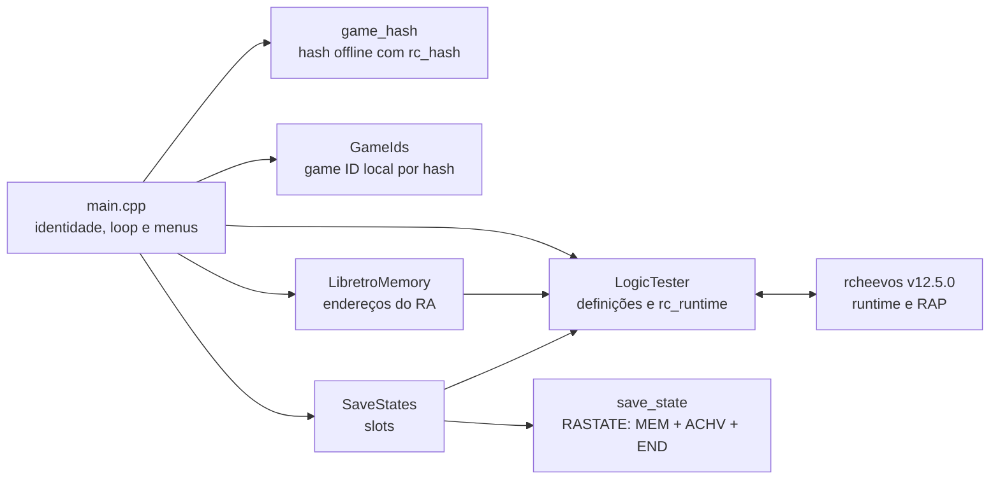

# 03 · Etapa 3: rcheevos ao vivo

Objetivo da etapa: identificar o jogo, testar lógica de conquistas ao vivo e manter o progresso do
tester junto dos save states enquanto você joga.

| Subetapa | Conteúdo | Status |
|---|---|---|
| 3.1 | Hash do jogo + game ID digitado | ✅ |
| 3.2 | Avaliar lógica a cada frame | ✅ |
| 3.3 | Progresso do tester junto com o save state | ✅ |

## Resumo da etapa

### O que a etapa entregou

A ferramenta calcula offline o hash de um jogo, deixa você informar o game ID e testar lógicas de
conquistas a cada frame emulado. O estado do tester — como hits acumulados e conquistas já
disparadas — acompanha o core ao salvar e carregar um slot. Nada é desbloqueado ou enviado ao
servidor.

### Mapa do código

### O caminho de um frame e de um save state

1. `main.cpp` sincroniza as definições do Achievement Tester com a sessão antes dos atalhos, mesmo
   pausada. Assim, o primeiro quadro da interface depois de carregar um slot não apaga o progresso
   recém-restaurado.
2. Quando a emulação roda, o core executa `retro_run()` e atualiza a memória. Logo depois,
   `LogicTester::do_frame` chama `rc_runtime_do_frame` uma vez para aquele frame emulado; os eventos
   resultantes atualizam a janela e o log.
3. Ao salvar, `SaveStates` serializa os bytes do core e, se recebeu um `LogicTester`, o progresso
   RAP. `save_state` os grava no container `RASTATE`: `MEM ` para o core, `ACHV` para o progresso e
   `END ` para terminar a lista.
4. Ao carregar, o arquivo é validado e o core precisa aceitar o bloco `MEM ` primeiro. Só então o
   tester tenta restaurar o bloco `ACHV` e revalida os endereços contra a memória restaurada. Esse
   caminho não avalia um frame extra.
5. Se o estado não tiver progresso ou o bloco for inválido, o core ainda carrega; o tester é
   reiniciado e a mensagem informa `runtime progress reset`.

### Conceitos mais importantes

- [O hash identifica o executável do jogo, e o game ID é local (3.1)](#31--hash-do-jogo--game-id)
- [O rcheevos avalia a lógica depois de cada frame emulado (3.2)](#32--testar-lógica-de-conquista-ao-vivo)
- [O runtime guarda estado de avaliação separado dos bytes do core (3.3)](#33--progresso-do-tester-junto-com-o-save-state)
- [O progresso só combina com a mesma definição: ID e MD5 da lógica (3.3)](#33--progresso-do-tester-junto-com-o-save-state)
- [O RAP fica dentro do bloco `ACHV` do container `RASTATE` (3.3)](#33--progresso-do-tester-junto-com-o-save-state)
- [Validar formatos antes de chamar leitores de estado protege a memória (3.3)](#33--progresso-do-tester-junto-com-o-save-state)
- [Carregar memória antes de revalidar endereços mantém o runtime coerente (3.3)](#33--progresso-do-tester-junto-com-o-save-state)

### Lições das revisões

- Um leitor que recebe o tamanho do buffer ainda pode fazer leituras internas sem checar cada
  limite. O pré-validador precisa refletir o formato que o leitor realmente percorre.
- Não altere o runtime ativo enquanto ainda está validando dados externos: reconstrua um runtime
  temporário e só o instale depois que a restauração inteira der certo.
- O progresso está associado à definição, não apenas ao número da conquista. Comparar o ID e o MD5
  da lógica evita transferir hits para uma lógica que mudou.
- O estado do core e o estado do tester têm destinos separados no arquivo. Um bloco `ACHV` inválido
  não precisa impedir a restauração válida do jogo, mas o usuário precisa saber que o progresso foi
  reiniciado.
- A etapa testa lógica localmente. O programa não chama a API do RetroAchievements e não publica
  conquistas.

### Prova da etapa

1. Por que o game ID é digitado mesmo depois de calcular o hash?
2. Em que ponto `rc_runtime_do_frame` é chamado, e por que o loop da interface não deve decidir a
   contagem de hits?
3. O que vai nos blocos `MEM ` e `ACHV` de um save `RASTATE`?
4. Que duas informações precisam combinar para reaproveitar o progresso de uma conquista?
5. Se a lógica mudou depois de salvar, em que estado essa definição começa ao carregar?
6. Por que o core precisa ser restaurado antes de revalidar os endereços das conquistas?
7. O que acontece com o jogo e com o tester quando o save não contém progresso ou tem um bloco
   `ACHV` inválido?

---

## 3.1 · Hash do jogo + game ID

### O que foi feito

- **`compute_game_hash`** (`src/devtools/include/cw/devtools/game_hash.hpp`): calcula o hash do
  RetroAchievements de um arquivo de jogo com o `rc_hash` do rcheevos, **offline**.
- **`GameIds`** (`src/frontend/game_ids.*`): guarda o game ID que você digita para cada hash em
  `~/.config/cheevo-workbench/game-ids.txt`. Você digita uma vez; nas próximas vezes ele aparece
  sozinho.
- **Janela Status:** mostra o hash (com botão "Copy") e o campo do game ID. O hash é recalculado
  quando outro jogo é carregado.
- **Issue #34 junto:** core ou jogo inexistente agora dizem "File not found: …" em vez da dica
  enganosa sobre o formato do arquivo.
- **Seu jogo:** hash `ca1c2444593a4dd5ce4946070cec61b3`, calculado em 0,3 ms.

### Conceitos

**O que é o hash e para que serve.** O RA não reconhece um jogo pelo nome do arquivo (cada um dá o
nome que quiser), e sim por uma "impressão digital" do conteúdo: o hash, 32 caracteres
hexadecimais. Cada versão do jogo (japonesa, americana, revisão 1.1…) tem o seu. O site liga cada
hash ao game ID, e cada game ID ao seu set de conquistas. Se o hash do seu arquivo não estiver
listado para o jogo, as conquistas não carregam com ele.

**Como o hash do PS1 é calculado** (`third_party/rcheevos/src/rhash/hash_disc.c`, `rc_hash_psx`):

1. Abre a trilha 1 do disco e lê o sistema de arquivos ISO9660 (o "pendrive" do CD: setor 16
   descreve o disco e aponta para o diretório raiz).
2. Acha o `SYSTEM.CNF` e lê a linha `BOOT = cdrom:\SLPS_xxx.xx;1`: o executável que o PS1 roda ao
   ligar.
3. Hash = **MD5(nome do executável + conteúdo do executável)**, com o tamanho tirado do cabeçalho
   `PS-X EXE` (+ 2048 bytes do próprio cabeçalho).

Por isso o hash não muda se o arquivo for renomeado, nem entre um `.bin/.cue` e outro formato de
imagem *do mesmo disco*: só o executável importa. (Isso é uma propriedade do algoritmo; para ler um
`.chd` a ferramenta ainda precisa de um leitor de CHD, que está em "Later / optional".)

**Por que digitar o game ID.** Descobrir o game ID a partir do hash exige perguntar ao servidor do
RA, e a regra 1 do projeto proíbe falar com o servidor sem aprovação. Então você olha o número na
página do jogo no site (o Twilight Syndrome é o 18238, na URL `/game/18238`) e digita uma vez.

**Testar sem jogo: um CD sintético.** O teste monta, byte a byte, um "CD de PS1" mínimo: o
descritor ISO9660 no setor 16 e o terminador no 17, um diretório raiz com `SYSTEM.CNF` e
`SLPS_123.45`, e um executável inventado. Ele tem as partes do ISO9660 que o leitor do rcheevos
usa (com os números nas duas ordens de bytes, como a norma pede), mas **não é uma imagem ISO9660
completa** (datas, tabelas de caminho e o tamanho do volume ficam zerados). Ele grava um `.bin` + `.cue` numa pasta temporária, e o rcheevos lê como se fosse um
jogo, pelo caminho de verdade. O hash esperado foi calculado **à parte, em Python** (`hashlib.md5`
sobre os mesmos bytes): se a nossa ligação com o rcheevos estivesse errada, os dois não bateriam.
Nenhum dado de jogo real entra no repositório.

**Erros por iterador.** O `rc_hash` aceita funções de log de erro de duas formas: globais
(`rc_hash_init_error_message_callback`, como o RALibretro faz) ou dentro do iterador
(`iterator.callbacks.error_message`). Usamos a segunda, com o `userdata` apontando para a string
de erro: cada cálculo coleta os seus próprios erros. (O `rc_hash` ainda tem estado global: os
leitores de arquivo e de CD configurados com `rc_hash_init_custom_*` entram em todo iterador. Não
configuramos nenhum, então ele usa os padrões.)

### Arquivos para ler (nesta ordem)

1. `src/devtools/game_hash.cpp`: curto; o iterador, os callbacks e o `rc_hash_generate`.
2. `tests/test_game_hash.cpp`: `make_ps1_disc` mostra a estrutura mínima de um CD de PS1.
3. `third_party/rcheevos/src/rhash/hash_disc.c`: `rc_cd_find_file_sector` (ISO9660) e
   `rc_hash_psx`.
4. `src/frontend/game_ids.cpp` e, em `main.cpp`, `update_game_identity` / `draw_game_identity`.

### O que aprendemos com a referência

- O RALibretro (`reference/RALibretro/src/Hash.cpp`) usa o mesmo `rc_hash_generate`, mas com
  callbacks globais, um leitor de arquivos próprio (por causa de nomes com acento no Windows),
  suporte a CHD (`HashCHD.cpp`, com a libchdr) e a zip, e conjuntos de discos (`.m3u`). Nós
  começamos com `.cue/.bin/.iso`; CHD está em "Later / optional".

### Na revisão do Codex (PR #37)

- **Game ID mudando em memória mesmo quando a gravação falhava.** Agora a mudança é feita numa
  cópia e só vale depois de gravada.
- **Jogo trocado pelo mesmo caminho mantinha o hash antigo.** O hash agora é recalculado a cada
  nova sessão de jogo, não só quando o caminho muda.
- **"Permissão negada" aparecia como "File not found".** A função `regular_file_problem` separa os
  três casos: não existe, não é arquivo, não deu para acessar (com o motivo do sistema).
- **Duas afirmações minhas nestas notas estavam fortes demais** ("o hash não muda com `.chd`" e
  "sem estado global"). Foram corrigidas acima. Notas de estudo também precisam estar certas.
- **O meu teste de permissão não testava nada.** O teste de mutação mostrou: com o bug de volta,
  ele só emitia um aviso. Corrigido. Lição: um teste que nunca falha não prova nada; quebrar o
  código de propósito é como se descobre isso.

### Problemas encontrados

- A checagem nova de "arquivo não encontrado" quebrou um teste antigo, que usava `libm.so.6` (um
  nome sem caminho, que o `dlopen` procura nas pastas do sistema) para testar "isto não é um core".
  Cores são sempre caminhos de arquivo, então o teste passou a usar um `.so` nosso
  (`tests/test_core/not_a_core.c`).

### Para fixar

1. Por que o RA usa um hash, e não o nome do arquivo, para reconhecer o jogo?
2. O que entra no hash de um jogo de PS1? Mudar o nome do `.bin` muda o hash?
3. Por que calculamos o hash esperado do teste em Python, e não com o próprio rcheevos?
4. Por que o game ID é digitado, e não buscado automaticamente?
5. Exercício: na página do Twilight Syndrome no site do RA, procure a lista de arquivos/hashes
   suportados (no navegador) e confira se `ca1c2444593a4dd5ce4946070cec61b3` está lá.

---

## 3.2 · Testar lógica de conquista ao vivo

### O que foi feito

- **`LogicTester`** (`src/devtools/include/cw/devtools/logic_tester.hpp`): uma camada fina sobre o
  `rc_runtime` do rcheevos, o mesmo motor que o RetroAchievements usa para avaliar conquistas.
  Você adiciona uma lógica (texto), e a cada frame emulado ele diz o que aconteceu: ativou,
  disparou, pausou, resetou os hits, mudou o valor medido, ou foi desativada por ler um endereço
  que não existe.
- **Janela View → Achievement Tester:** título + lógica, tabela com o estado de cada conquista
  (Waiting / Active / Primed / Triggered / Disabled), o valor medido, botões Re-arm e Remove, e
  um log de eventos com o número do frame. Quando uma conquista dispara, aparece
  "Achievement triggered: …" sobre o jogo.
- **Nada é desbloqueado nem enviado.** As conquistas existem só na memória do programa (ler e
  gravar o `-User.txt` é o passo 4.2).
- **Com o Beetle PSX e o seu jogo:** "o byte em `0x00E200` mudou" disparou no frame 101; uma
  lógica com endereço fora do PS1 (`0x300000`) foi desativada antes de rodar; uma medida mostrou
  `1 / 255`.

### Conceitos

**Como uma conquista "vive" no rcheevos** (`rc_runtime_types.h`, `RC_TRIGGER_STATE_*`):

| Estado | Significado |
|---|---|
| Waiting | Acabou de ser ativada; **não dispara** até a condição ter sido falsa pelo menos uma vez |
| Active | Pode disparar |
| Primed | Tudo verdadeiro, menos as condições `Trigger` (`T:`): está "a um passo" |
| Paused | Uma condição `PauseIf` está verdadeira |
| Triggered | Disparou |
| Disabled | Lê um endereço que a memória não tem |

**Por que o "Waiting" existe.** Imagine carregar um save state em que a condição já é verdadeira
(por exemplo, "está no capítulo 3"). Sem o Waiting, a conquista dispararia na hora, sem você ter
feito nada. O rcheevos exige ver a condição **falsa** antes, para só disparar quando ela *passa a
ser* verdadeira.

**Uma avaliação por frame emulado, logo depois do frame.** É assim que o RA avalia: o jogo roda
um frame, e então as condições são checadas contra a memória daquele frame. Hit counts
(`.3.` = "verdadeira em 3 frames") contam frames emulados. Por isso o avanço de frame (N) avalia
exatamente um frame, e pausado (P) nada é avaliado.

**O `peek`.** O rcheevos não lê a memória sozinho: ele chama uma função nossa pedindo "1, 2 ou 4
bytes a partir do endereço X", e nós respondemos montando os bytes em little-endian a partir da
`MemoryReader` do 2.1. Os 24 bits são lidos como 4 e mascarados pelo próprio rcheevos.

**Callbacks sem contexto, de novo.** As funções de evento e de validação do `rc_runtime` não
recebem um ponteiro de contexto. A solução é a mesma do 1.2 (`s_active`): um ponteiro
`thread_local` aponta para a lista de eventos só durante a chamada.

**Ao trocar ou recarregar o jogo**, o motor é **reconstruído do zero**: todas as conquistas voltam
para Waiting, os hits são zerados, e os endereços são revalidados contra a memória nova. (Veja na
revisão abaixo por que um simples `rc_runtime_reset` não bastava.)

### Arquivos para ler (nesta ordem)

1. `src/devtools/include/cw/devtools/logic_tester.hpp`: a interface e os comentários.
2. `tests/test_logic_tester.cpp`: cada teste conta uma regra do rcheevos (frame exato, Waiting,
   hits, reset, medida, endereço inválido).
3. `src/devtools/logic_tester.cpp`: `peek`, `collect_event`, `validate_addresses`.
4. `src/frontend/main.cpp`: `sync_achievement_tester`, `record_logic_events` e onde `do_frame` é
   chamado (logo depois de `core.run_frame`).
5. Referência: `third_party/rcheevos/src/rcheevos/runtime.c` (`rc_runtime_do_frame`) e
   `trigger.c`.

### O que aprendemos com a referência

- O `rc_runtime` faz todo o trabalho de avaliação (o RALibretro entrega isso ao RAIntegration,
  que usa o `rc_client`, a camada que também conversa com o servidor; nós usamos só o motor,
  sem servidor).
- Reativar uma conquista com a mesma lógica não cria outra: o rcheevos compara um checksum da
  lógica e apenas a reseta (`rc_runtime_activate_achievement`). É assim que o Re-arm funciona.

### Na revisão do Codex (PR #41)

- **Endereço inválido "grudava" depois de trocar de jogo.** Quando um endereço não pode ser lido,
  o rcheevos marca a leitura daquele endereço como "não ler mais" (`RC_VALUE_TYPE_NONE`, em
  `runtime.c`). O `rc_runtime_reset` zera os hits, mas **não desfaz essa marca**. Resultado: num
  jogo em que o endereço existe, a conquista aparecia como Waiting/Active e **nunca mais lia a
  memória**, sem avisar. Correção: ao trocar de jogo, o motor é reconstruído do zero (todas as
  lógicas são lidas de novo); e o Re-arm fica indisponível para conquistas desativadas. Um teste
  reproduzia o bug antes da correção (a conquista não disparava).
- **Leitura no fim da memória:** um valor de 2 ou 4 bytes começando no último byte legível lê os
  bytes que faltam como zero, como o RAIntegration faz; agora há um teste para isso.
- Lição: ler o código da biblioteca (aqui, o que o `rc_runtime_reset` *não* faz) pega bugs que
  nenhum teste "do caminho feliz" mostraria.

### Problemas encontrados

- Faltou um include (`rc_runtime_types.h`, onde ficam os estados e a estrutura completa do
  `rc_trigger_t`); o compilador apontou na hora.
- Teste de mutação: inverter a ordem dos bytes no `peek` (big-endian) derruba 7 testes.

### Para fixar

1. Por que uma conquista recém-adicionada cuja condição já é verdadeira não dispara?
2. O que significa `0xH0010=1.3.`? Em quantos frames ela precisa ser verdadeira?
3. Por que a avaliação acontece depois de cada frame emulado, e não a cada quadro da interface?
4. O que acontece com os hit counts quando você carrega outro jogo? E por quê?
5. Exercício: no jogo, abra o Achievement Tester e adicione `d0xH00E200!=0xH00E200` ("o byte
   mudou desde o frame anterior"). Ele dispara? Aperte Re-arm, pause (P) e avance (N): em qual
   frame dispara de novo?

---

## 3.3 · Progresso do tester junto com o save state

### O que foi feito

- `LogicTester::serialize_progress` e `deserialize_progress` (`src/devtools/logic_tester.*`)
  gravam e restauram o progresso RAP do `rc_runtime` usando as APIs com tamanho explícito do
  rcheevos v12.5.0.
- O progresso de cada definição só volta quando o ID e o MD5 da lógica combinam. Uma definição
  alterada ou nova começa em Waiting; uma que já não existe é ignorada. Hits, valores medidos e
  referências de memória necessárias à avaliação acompanham as definições compatíveis.
- `SaveStates` (`src/frontend/save_states.*`) recebe o tester como parâmetro opcional. A UI o passa
  tanto pelo menu States quanto pelos atalhos. O container `RASTATE` existente guarda os dados do
  core em `MEM ` e, quando disponíveis, os dados RAP em `ACHV`, seguido por `END `.
- O escritor nativo do rcheevos não preserva os estados Triggered e Disabled. Para o tester offline,
  um chunk de extensão `CWST` no RAP guarda ID, MD5 da lógica, estado terminal e valor medido. O
  checksum RAP é recalculado; o leitor padrão do rcheevos ignora esse chunk desconhecido pequeno.
- O carregamento só tenta alterar o runtime depois que `LibretroCore::unserialize_state` aceita os
  dados do core.
  Sem `ACHV` ou com progresso inválido, o core ainda carrega, o tester é reiniciado e a mensagem
  explica `runtime progress reset`. Depois da restauração, os endereços são revalidados contra a
  memória do core carregada. A restauração não avalia um frame adicional.
- O método do tester constrói um runtime temporário, restaura e valida tudo nele e só então troca o
  runtime ativo. Se a validação falhar, o método mantém o estado ativo intacto. Títulos e textos de
  lógica continuam pertencendo à sessão do tester; persistir definições é o passo 4.2, ainda fora
  deste escopo. Tudo permanece local e offline.

### Conceitos

**Dois formatos dentro do mesmo arquivo.** `RASTATE` é o envelope do save state: tem uma versão e
blocos com tag, tamanho little-endian, conteúdo e padding de 8 bytes. O bloco `MEM ` contém o estado
do core libretro. O bloco `ACHV` contém outro formato: RAP, usado pelo rcheevos para progresso de
runtime. São responsabilidades separadas: restaurar o core volta a memória do jogo; restaurar RAP
volta a avaliação das lógicas.

**A identidade de uma definição é mais que o ID.** IDs organizam os itens da sessão, mas podem ser
reutilizados quando uma definição é editada. O MD5 calculado pelo rcheevos representa a lógica
em texto. Exigir ID e MD5 iguais evita colocar os hits antigos numa condição que mudou. O runtime
novo começa todas as definições em Waiting; somente as que combinam recebem o progresso salvo.

**O que o formato RAP guarda.** O RAP começa com `RAP\n` e termina com o chunk `DONE`, que inclui o
MD5 dos bytes anteriores. Os chunks conhecidos incluem referências de memória (`MREF`) e estado de
conquista (`ACHV`). O rcheevos v12.5.0 oferece variantes *sized* das funções de serialize e
deserialize para que o tamanho do buffer seja informado.

**Por que existe `CWST`.** O escritor nativo salva progresso ativo, mas deixa de fora conquistas
Triggered e Disabled. O tester precisa reproduzir esses estados localmente ao recarregar um slot.
Cada `CWST` é uma extensão privada pequena que leitores RAP padrão ignoram; o seu conteúdo só é
aplicado se ID e MD5 ainda identificam uma definição presente. Ela não altera a lista de conquistas
nem significa que algo foi desbloqueado no serviço.

**Uma função `sized` ainda precisa de pré-validação.** No rcheevos compilado, o leitor RAP limita
os chunks ao buffer fornecido, mas seus leitores internos de condições percorrem os dados com
leituras que não conferem, uma a uma, o tamanho do chunk. Por isso o tester valida antes os campos,
grupos, condições e valores indiretos que o leitor interno vai consumir. Só depois passa os bytes
ao rcheevos.

**A ordem do load protege os dois estados.** O core é carregado primeiro porque o runtime precisa
validar endereços no mapa de memória resultante. O runtime temporário evita estado parcial se o RAP
estiver truncado ou corrompido. Na integração com `SaveStates`, uma falha de progresso vira um
reset deliberado com aviso; ela não invalida um estado do core que já foi restaurado.

### Arquivos para ler (nesta ordem)

1. `src/devtools/include/cw/devtools/logic_tester.hpp`: contrato de serialize/deserialize e
   limites de tamanho.
2. `src/devtools/logic_tester.cpp`: pré-validação, correspondência ID + MD5, extensão `CWST` e
   runtime temporário.
3. `src/frontend/save_state.hpp` e `src/frontend/save_state.cpp`: blocos `RASTATE`, alinhamento,
   validação dos limites e leitura do bloco `ACHV`.
4. `src/frontend/save_states.hpp` e `src/frontend/save_states.cpp`: ordem de salvar/carregar, falha
   de progresso, aviso e revalidação de endereços.
5. `src/frontend/main.cpp`: sincronização do tester antes dos atalhos, chamada após cada frame e
   passagem do tester pelos menus e hotkeys de save/load.
6. `third_party/rcheevos/src/rcheevos/runtime_progress.c`: formato RAP, API *sized*, checksum e
   comportamento dos chunks desconhecidos no v12.5.0 compilado.
7. Referência de formato, sem copiar código: `reference/RALibretro/src/States.cpp`,
   `saveState`/`loadRAState1`, que confirma o envelope `RASTATE` e as tags `MEM `, `ACHV`, `SCRN` e
   `END `.

### O que aprendemos com a referência

- O RALibretro grava o bloco de dados do core em `MEM ` e, se houver captura de conquistas, o RAP
  em `ACHV`; os blocos terminam em `END `. A ferramenta segue esse envelope e aceita arquivos
  `RASTATE` sem dados de conquistas, além de estados crus de core.
- O runtime do rcheevos escreve `RAP\n`, seus próprios chunks e um checksum final. No v12.5.0, um
  chunk desconhecido menor que 64 KiB é pulado, então `CWST` pode preservar estado exclusivo do
  tester sem mudar os chunks nativos.
- `rc_runtime_deserialize_progress_sized` pode resetar o runtime que recebe quando encontra dados
  inválidos. A restauração em runtime temporário contém esse efeito: se falhar, o runtime que o
  usuário estava usando não foi parcialmente substituído.
- Seguimos os formatos confirmados nas referências, mas não copiamos código do RALibretro nem do
  rcheevos.

### Problemas encontrados

- O leitor RAP com tamanho explícito verifica os limites dos chunks, mas a leitura de condições
  dentro de `ACHV` não aplica todos esses limites. O pré-validador do tester passou a espelhar os
  campos que o parser de lógica construiu para impedir que um buffer malformado cause leitura fora
  do chunk antes da validação do checksum.
- A mudança de runtime precisa ser atômica. Como o desserializador do rcheevos reseta o runtime que
  recebe ao falhar, chamar essa função no runtime ativo perderia o progresso anterior; agora ele só
  é chamado no runtime temporário.
- Se todas as definições que leem memória forem removidas, o leitor `MREF` do rcheevos ainda
  presume uma referência de destino. Após validar o checksum original, o wrapper retira esse
  chunk agora sem uso de uma cópia temporária e recalcula seu checksum antes de chamar o leitor.
  Isso também permite carregar um estado antigo quando só restam condições constantes.

### Na revisão

A implementação foi revisada junto dos testes preparados pela Luna. Um dos testes de corrupção
alterava um valor indireto em vez da flag da condição seguinte; corrigimos o deslocamento para
que ele realmente exigisse bytes ausentes. Os testes estruturais recalculam o checksum depois de
corromper os campos, verificando a proteção dos limites além da simples rejeição por MD5.

A validação terminou com 142 casos e 7.388 verificações passando, build sem warnings,
`clang-format` e ASan+UBSan. LeakSanitizer ficou desativado pela limitação de ptrace do sandbox.
Uma mutação em um objeto compilado temporário, retirando a restauração de progresso, fez o teste
de restauração falhar em cinco verificações; o código do repositório não foi modificado por essa
mutação.

Um programa auxiliar executou 608 frames com o Beetle PSX e Twilight Syndrome. Restaurou os
2 MB de RAM e a sequência `2/5 → Triggered → carregar → 2/5 → Triggered`, além dos estados
terminais e da carga legada sem `ACHV`. Outro programa com ImGui, sem janela gráfica, confirmou
**Shift+F4**, **F4** com a sessão pausada e **Ctrl+R** reiniciando o progresso. Os slots de teste
ficaram em `/tmp`; a interação na interface real continua aguardando o teste do usuário.

### No teste do usuário

O teste `2/5 → Triggered → carregar → 2/5` funcionou na interface. Porém, carregar o slot 1
antigo deixava o jogo sem responder enquanto o contador de frames continuava avançando; a intro
também estava diferente. Reproduzimos o comportamento com os slots 1 e 4, somente lendo os
arquivos: sem a BIOS original no diretório de sistema, o core aceitava o save e emitia frames
idênticos mesmo com botões pressionados. Com a pasta de BIOS real, os mesmos slots voltavam a
produzir imagens diferentes. Os saves originais não foram modificados.

O comando de teste sem `--system` usava a pasta XDG padrão vazia, em vez da pasta fornecida nos
testes anteriores. O Beetle PSX instalado permite iniciar sem o firmware original, então aceitar
o jogo ou o save não demonstrava que a mesma BIOS estava sendo usada. Agora a pasta é selecionada
em **File → System (BIOS) Directory**, fica salva para os próximos lançamentos e aparece em
Status. Informar `--system` também memoriza a seleção. Depois de mudar a pasta, é necessário
reabrir o jogo antes de carregar o slot.

Depois de configurar a BIOS e reabrir o jogo, o usuário confirmou o funcionamento da intro e do
carregamento dos slots, sem o travamento relatado. A etapa 3.3 está validada manualmente.

### Para fixar

1. No `RASTATE`, que dados vão em `MEM ` e quais vão em `ACHV`? Por que o RAP não substitui o estado
   do core?
2. Por que uma lógica com o mesmo ID, mas MD5 diferente, começa em Waiting?
3. Qual parte da leitura o pré-validador confere além do tamanho total do buffer?
4. Exercício manual: pause o jogo, adicione `M:1=1.5.` no Achievement Tester e tire o foco do
   campo de texto. Avance dois frames com **N**, confira `2 / 5` e salve com **Shift+F4**.
   Avance três frames até disparar; carregue com **F4** e confira que voltou a `2 / 5` e Active.
   Avance mais três frames e confirme que dispara de novo. Depois salve já em Triggered e
   recarregue para conferir que o estado terminal também persiste. A lógica conta frames sem
   ler ou alterar a RAM; escolha outro slot se precisar conservar o conteúdo do slot 4.
