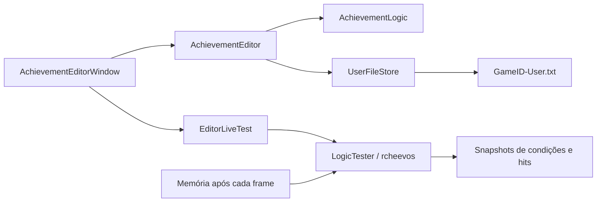

# 04 · Etapa 4: editor de conquistas e arquivos locais

Objetivo da etapa: editar conquistas no Linux e produzir arquivos locais compatíveis com o
RAIntegration, para publicação posterior pela ferramenta oficial.

## Resumo da etapa

### O que a etapa entregou

O workbench permite criar conquistas locais: metadados, condições, flags, operandos, alvos de
hits e grupos Core/Alt. A sessão salva arquivos compatíveis com o RAIntegration e testa a
conquista selecionada contra a memória emulada. O usuário aprovou o merge após testes parciais;
o ajuste mais recente do layout de Code Notes ainda aguarda confirmação manual.

### Mapa do código

### O caminho de um frame

1. O front-end executa o core e disponibiliza sua memória.
2. O runtime compartilhado avalia as definições uma única vez por frame emulado.
3. O editor busca um snapshot por ID, sem executar outra avaliação durante o desenho.
4. Core/Alts exibem comparações armazenadas e hits próprios das condições.
5. Mudanças de lógica ou de identidade encerram o teste anterior. Save mantém seu progresso;
   save states preservam o progresso pelo runtime da etapa 3.3.

### Os conceitos mais importantes

- Modelo editável separado do runtime: 4.1.
- Preservação textual e gramática verificada na biblioteca compilada: 4.1–4.2.
- Documento com registros conhecidos e linhas preservadas: 4.2.
- Gravação atômica e recusa de substituição de arquivo alterado externamente: 4.2.
- Rascunho válido versus texto de input ainda rejeitado: 4.3.
- Identidade de seleção diferente de índice e de revisão visual: 4.3–4.4.
- Comparação bruta, alvo de hits e resultado da cadeia: 4.4.

### Lições das revisões

O runtime reorganiza o armazenamento, mas seu encadeamento mantém a ordem textual. Recarregar
um documento pode substituir uma conquista por outra idêntica no mesmo índice. Um número
inválido não pode desaparecer quando o usuário troca um tipo. Alterar uma flag não autoriza
apagar permanentemente o alvo oculto. As revisões e os probes de interação cobriram esses casos,
além de Save/Reload, Core/Alt, saída com mudanças e falhas de gravação.

### Prova da etapa

1. Por que o modelo não guarda ponteiros para condições do runtime?
2. O que impede salvar um rascunho contendo um endereço digitado como `zz`?
3. Por que uma comparação pode estar falsa com o alvo de hits completo?
4. Como Reload difere de Save para a identidade do teste ao vivo?
5. Qual informação do arquivo local precisa ser preservada mesmo sem edição na UI?

| Subetapa | Conteúdo | Status |
|---|---|---|
| 4.1 | Modelo editável de lógica e serializador | ✅ |
| 4.2 | Leitura e escrita de `-User.txt` | ✅ |
| 4.3 | Interface do editor | ✅ — implementada; merge aprovado após teste parcial |
| 4.4 | Estado de cada condição ao vivo | ✅ — implementada; merge aprovado após teste parcial |

## 4.1 · Modelo editável de lógica

### O que foi feito

`AchievementLogic` representa um grupo Core e uma lista ordenada de grupos Alt. Cada grupo
contém condições com flag, operando esquerdo, operador, operando direito opcional e alvo de hits.
Os operandos representam endereço, delta, prior, BCD, inversão, inteiro, float e Recall. Funções
legadas `@name` são preservadas, embora o rcheevos não implemente sua avaliação.

`parse_achievement_logic()` transforma a string em valores editáveis. A leitura usa o parser do
rcheevos v12.5.0 para reconhecer condições e operandos, mantendo as condições na ordem textual.
`serialize_achievement_logic()` monta a string e verifica o resultado com o mesmo parser.
Tudo fica em `cw_devtools`, sem SDL, interface gráfica, arquivos ou acesso a servidores.

Essa subetapa é a base interna do editor. A janela de edição pertence à 4.3; a leitura e escrita
de `RACache/Data/<GameID>-User.txt` pertencem à 4.2.

### Conceitos

**Modelo de edição e modelo de execução têm objetivos diferentes.** O runtime do rcheevos
reorganiza condições para avaliar pausas, resets e outras classes eficientemente, além de
transformar cadeias de operações em referências modificadas. O editor precisa preservar a ordem
que o autor escreveu. Por isso, lemos com `rc_parse_condition_internal()` e `rc_parse_operand()`
em um contexto temporário, antes dessas transformações, e copiamos apenas os valores necessários.
A estrutura pública não guarda ponteiros nem contadores do runtime.

**Preservar texto exige guardar mais do que o valor.** `hA`, `10` e `00010` podem representar o
mesmo inteiro. `=` e `==` representam a mesma comparação, e os hits aceitam `.3.` e `(3)`.
Cada token guarda sua grafia e uma referência ao valor original. Ao serializar, um token que
continua com o mesmo valor reutiliza sua grafia. Um token alterado recebe a forma canônica.
Desfazer uma edição também recupera a grafia inicial.

O alvo de hits é um `std::optional<uint32_t>`: ausência, `.0.` e `.3.` não são a mesma escrita.
`required_hits.reset()` remove o sufixo; atribuir zero mantém um alvo explícito com valor zero.
Isso permite preservar uma escrita legada e ainda oferecer uma remoção explícita no editor.

Por exemplo, ao ler `p:0Xh00aF==hA(03)` e mudar apenas o valor da direita para 11, o resultado
é `p:0Xh00aF==11(03)`: a flag minúscula, o endereço e o alvo continuam intactos. Novos endereços
usam prefixos de tamanho compatíveis com o RAIntegration e pelo menos seis dígitos hexadecimais,
suficientes para a RAM do PS1; endereços maiores não são truncados. A largura visual exata usada
pelo RAIntegration depende do contexto do console, portanto não é universal.

**Separadores dependem do contexto.** O `S` de `0xS0010` seleciona o bit 6; outro `S`, após uma
condição, inicia um grupo Alt. O espaço em `0x 0010` seleciona 16 bits e não pode ser removido
como se fosse espaçamento decorativo. O parser também aceita grupos vazios e `s` minúsculo entre
grupos, com as restrições da versão compilada.

**Validar o prefixo não basta.** `rc_trigger_size()` pode aceitar um prefixo válido seguido por
texto extra. A leitura local exige consumir toda a entrada e rejeita NUL embutido. Depois disso,
a validação do trigger completo detecta restrições entre condições, como alvos Measured
incompatíveis. Os erros de leitura indicam grupo, condição e posição do token quando disponíveis.

**Uma edição não pode mudar silenciosamente de valor.** Antes de devolver a string, o serializer
a lê novamente e compara os campos e a estrutura com o modelo solicitado. Isso detecta, por
exemplo, floats que o parser truncaria ou nomes de função que engoliriam um separador.
Floats usam ponto decimal e não usam notação exponencial; valores não finitos são rejeitados.
A entrada e a saída têm limite de 1 MiB.

### Arquivos para ler (nesta ordem)

1. `src/devtools/include/cw/devtools/achievement_logic.hpp`: grupos, condições e operandos.
2. `src/devtools/achievement_logic.cpp`: leitura, preservação dos tokens e serialização validada.
3. `tests/test_achievement_logic.cpp`: exemplos sintéticos e edições estruturais.
4. `third_party/rcheevos/src/rcheevos/condition.c`: flags, operadores e hits.
5. `third_party/rcheevos/src/rcheevos/operand.c` e `memref.c`: operandos e tamanhos.
6. `third_party/rcheevos/src/rcheevos/condset.c` e `trigger.c`: grupos e validação completa.
7. `reference/RAIntegration/src/devkit/data/util/AchievementLogicSerializer.cpp`: grafia emitida
   pela ferramenta de referência, usada para conferir a compatibilidade.

### O que aprendemos com a referência

- O serializer do RAIntegration emite flags maiúsculas, `=` para igualdade e `.N.` para hits;
  zero não precisa de sufixo. Esses formatos orientam a escrita de campos novos ou alterados.
- Os tamanhos de lógica incluem bit count, 16/24/32 bits big-endian e seis formatos de memória
  em ponto flutuante (`fF`, `fB`, `fH`, `fI`, `fM`, `fL`). O enum do viewer não cobre tudo isso,
  então o modelo de lógica tem seu próprio enum de tamanhos.
- Em `A:`, `B:` e `I:`, o rcheevos aceita comparações legadas e ignora a parte comparada na
  execução. O modelo expõe o efeito real (`op=None`, sem direita nem alvo de hits) e mantém
  a escrita legada em metadados enquanto a condição permanecer intacta. Após uma edição,
  emite a forma efetiva sem o comparador ignorado. Tentar criar uma nova comparação desse
  tipo produz erro, em vez de sugerir que a comparação terá efeito.
- `M:` sem operador é permitido em expressões de valor, mas não em triggers de conquistas.
  A validação precisa usar o contexto certo, não apenas o parser isolado de uma condição.

### Problemas encontrados

- **Uma leitura aceita não garante uma escrita fiel:** reconstruir tudo no formato canônico
  apagaria diferenças de caixa, zeros à esquerda e formas legadas. Os metadados privados de
  preservação evitam isso sem exigir que cada consumidor gerencie flags de alteração.
- **Testar apenas ida e volta deixaria uma lacuna:** um token intacto reutiliza seu texto e não
  exercita a tabela de escrita canônica. Os testes também alteram endereços, tipos, flags e
  alvos, relêem a saída e verificam os campos, além de conferir a aceitação pelo rcheevos.
- **O parser isolado usa APIs internas:** essa dependência fica restrita ao `.cpp` e à versão
  fixada do submódulo. Uma atualização do rcheevos deve passar pelos testes de compatibilidade
  antes de mudar a versão compilada.
- **Na revisão:** comparações ignoradas em `A/B/I` passaram a aparecer no modelo pelo efeito
  real, e o alvo de hits passou a ser opcional para permitir remover um zero explícito. Os
  testes verificam preservação, edição e desfazer nesses dois casos.

### Verificação

Build e formatação passaram sem avisos. A suíte passou com **161 casos e 8.594 asserções**,
incluindo execução com AddressSanitizer e UndefinedBehaviorSanitizer; LeakSanitizer foi
desativado por limitação do ambiente. Os exemplos são sintéticos e as saídas são conferidas com
`rc_trigger_size()` e `rc_parse_trigger()` da biblioteca compilada. A comparação de eventos em
memória sintética também confirma a equivalência de uma lógica após edição.

Um teste de mutação trocou temporariamente o prefixo canônico de 8 bits pelo de 24 bits. O teste
de compatibilidade falhou; após restaurar o código, a suíte completa voltou a passar. Isso
confirma que a bateria detecta uma escrita incorreta, além de preservar strings intactas.

Esta subetapa não altera a interface do aplicativo. A verificação direta pode ser repetida com
`ctest --test-dir build --output-on-failure`; a edição visual será testada na 4.3.

### Para fixar

1. Por que serializar diretamente as condições do trigger de runtime pode mudar a ordem escrita?
2. O que se perde ao guardar somente o número 10, sem a grafia do token que o representava?
3. Por que `0xS0010` não pode ser dividido procurando todos os caracteres `S` da string?
4. Qual é a diferença entre um grupo Core vazio e a ausência de grupos Alt?
5. Por que o serializer lê novamente a string depois de montá-la?
6. Exercício: nos testes, crie uma condição em um grupo Alt, altere seu alvo de hits, mova-a para
   o Core e verifique a string e o modelo relido. Use apenas endereços e dados sintéticos.

## 4.2 · Arquivos locais `-User.txt`

### O que foi feito

`UserFileDocument` representa os cabeçalhos e os registros de um arquivo local compatível com
`RACache/Data/<GameID>-User.txt`. Conquistas usam o modelo de lógica da 4.1. Leaderboards guardam
Start, Cancel e Submit nesse modelo e a expressão Value como texto, pois ela usa outra gramática.
Essa etapa não ativa nem submete leaderboards; a avaliação ao vivo pertence à 6.2.

`parse_user_file()` e `serialize_user_file()` trabalham somente com texto. `UserFileStore` é a
camada de acesso explícito ao disco: carrega, verifica alterações externas e salva por substituição
atômica. Não há integração automática com o RACache nem controles novos na interface. Eles virão
no editor da 4.3.

### Conceitos

**O cabeçalho não é uma versão de esquema.** O RAIntegration lê e descarta as duas primeiras
linhas: a versão do programa que escreveu e o título do jogo/subset principal. Não compara a
primeira linha com uma lista de versões aceitas. Portanto, guardamos esse texto literalmente,
inclusive versões desconhecidas. Arquivos novos identificam o programa como
`cheevo-workbench 0.1.0`.

**O registro tem uma posição para cada campo.** Os campos são separados por `:`, mas texto entre
aspas pode conter esse caractere sem encerrar o campo. O ID pode ter um subset explícito, como
`17|42`. Um ID zero solicita que o RAIntegration atribua um ID local ao importar; não é o game ID.
O game ID faz parte do nome do arquivo.

| Campo | Conquista | Leaderboard |
|---|---|---|
| 1 | ID, com subset opcional | `L` + ID, com subset opcional |
| 2 | Trigger | Start |
| 3 | Título | Cancel |
| 4 | Descrição | Submit |
| 5 | Progresso, não usado | Value |
| 6 | Máximo de progresso, não usado | Formato |
| 7 | Tipo | Título |
| 8 | Autor | Descrição, opcional em arquivos legados |
| 9 | Pontos | Menor valor é melhor, opcional; qualquer número não zero significa verdadeiro |
| 10–13 | Criação, modificação, votos positivos e negativos; não usados | — |
| 14 | Badge | — |

**Não basta dividir a linha em todos os dois-pontos.** Triggers escritos pelo RAIntegration são
sempre citados: `"M:0xH000001=5"`. Texto comum só precisa de aspas quando contém `:`, aspas,
barra invertida, tabulação ou quebra de linha. Dentro das aspas, `\"`, `\\`, `\n`, `\r` e `\t`
representam os caracteres correspondentes. O tokenizer de referência também remove a barra de
escapes desconhecidos; guardamos o token original para não reescrever esses casos sem edição.
O trigger de conquista não citado tem um caminho legado específico no reader, com uma lista
limitada de flags cujos dois-pontos fazem parte da lógica; não estendemos essa lista por conta
própria. Ao editar esse campo, a escrita passa a usar aspas.

**Editar uma parte não deve apagar as outras.** Cada registro guarda seus tokens originais e os
valores equivalentes do modelo. Um título alterado recebe um token novo, enquanto zeros à esquerda,
escapes antigos e outros campos intactos mantêm seus bytes. As posições de progresso, datas e
votos são preservadas mesmo que o RAIntegration atual as ignore. Qualquer extensão depois do último
campo conhecido é mantida como texto bruto. Linhas `N`, `M`, `BadgeDir=`, desconhecidas e vazias
ficam como registros de passagem, sem API de autoria de notas ou badges nesta etapa.

**O valor mostrado pode ter uma grafia diferente no arquivo.** O RAIntegration completa badges
curtos à esquerda até cinco caracteres. Assim, o modelo lê `123` como `00123`, mas guarda o token
`123` e o reutiliza enquanto o badge não mudar. Um leaderboard com valor numérico `2` em "menor é
melhor" é lido como verdadeiro, mas o token `2` continua intacto; uma edição usa `0` ou `1`.

**Compatibilidade de arquivo difere da validação para publicação.** O formato permite rascunhos
com lógicas ou Value vazios. Pontos são um inteiro sem sinal de 32 bits; o conjunto de pontos
permitido para publicação é uma regra de autoria do editor. Da mesma forma, mantemos o texto de
tipos e formatos desconhecidos: o RAIntegration interpreta tipos desconhecidos numericamente e
formatos desconhecidos como `VALUE`. Isso não significa que sejam opções válidas para uma nova
conquista publicada; a interface da 4.3 deverá oferecer as opções reconhecidas.

**Erros devem bloquear a gravação.** Campos obrigatórios ausentes, aspas não fechadas, inteiros
fora do intervalo, NUL embutido, lógicas inválidas e IDs não zero duplicados do mesmo tipo causam
falha com linha/campo no diagnóstico. O reader de referência é mais permissivo em alguns desses
casos; recusá-los aqui preserva o arquivo para correção, em vez de carregar uma lista parcial e
salvar por cima. Um arquivo existente de zero bytes também é tratado como erro: o RAIntegration o
considera ausente, mas aqui evitamos substituir silenciosamente um arquivo possivelmente truncado.
O limite total é de 16 MiB.

**Troca atômica evita um arquivo pela metade.** Ao carregar, o store fixa um caminho absoluto e
guarda os bytes lidos. Um arquivo ausente cria apenas um documento em memória. Ao salvar:

1. Serializa e valida o documento inteiro antes de escrever.
2. Compara o arquivo atual com o snapshot, recusando alterações ou remoção desde a leitura.
3. Cria um temporário único no mesmo diretório, escreve em laço, sincroniza com `fsync()` e fecha.
4. Compara o snapshot novamente, agora imediatamente antes da substituição.
5. Faz `rename()` e só então atualiza o documento e o snapshot em memória.

Erros removem o temporário e deixam a versão anterior intacta. As permissões comuns do arquivo
existente são preservadas. Links simbólicos no componente final e entradas que não são arquivos
regulares são recusados. A dupla comparação detecta alterações externas usuais, mas não é um lock
compartilhado com outro programa escrevendo exatamente no intervalo final. Também não é uma
promessa de recuperação após qualquer encerramento fatal ou queda de energia.

### Arquivos para ler (nesta ordem)

1. `src/devtools/include/cw/devtools/user_file.hpp`: documento, conquistas e leaderboards.
2. `src/devtools/user_file.cpp`: leitura dos campos, tokens preservados e serialização.
3. `src/devtools/include/cw/devtools/user_file_store.hpp` e `user_file_store.cpp`: estado de leitura
   e substituição atômica.
4. `tests/test_user_file.cpp` e `tests/test_user_file_store.cpp`: exemplos sintéticos e falhas de I/O.
5. `reference/RAIntegration/src/devkit/data/models/GameAssets.cpp`: cabeçalhos, dispatch e IDs.
6. `reference/RAIntegration/src/devkit/data/models/AchievementModel.cpp` e `LeaderboardModel.cpp`:
   ordem dos campos e valores padrão.
7. `reference/RAIntegration/src/devkit/data/models/AssetModelBase.cpp` e
   `reference/RAIntegration/src/devkit/util/Tokenizer.cpp`: aspas e escapes.
8. `reference/RAIntegration/src/services/impl/FileLocalStorage.cpp`: caminho do RACache.
9. `third_party/rcheevos/src/rcheevos/value.c` e `format.c`: Value e formatos da versão compilada.

### O que aprendemos com a referência

- O writer da referência reconstrói o arquivo e zera campos que não usa. Nosso editor ainda
  não conhece todos os registros, então precisa preservar essas informações separadamente.
- Leaderboards legados podem omitir descrição e a opção de menor valor. A leitura assume vazio
  e falso; a serialização mantém essa omissão enquanto esses campos não forem editados.
- Um trigger válido não basta para validar Value. `M:0xH000001` é uma expressão de valor válida,
  embora a 4.1 recuse essa forma sem comparação como trigger de conquista. Usamos o parser de
  valores do rcheevos e verificamos o consumo de todo o campo.
- O RAIntegration escreve CRLF, e seu reader também aceita LF. Preservamos os terminadores de
  cada linha; novas linhas seguem o estilo do cabeçalho, e a ausência de quebra no fim é mantida.

### Problemas encontrados

- **Caminho relativo não pode trocar de destino depois do load:** o store converte para absoluto
  antes de ler. Um teste muda o diretório corrente entre leitura e escrita e confirma o destino.
- **Última linha sem terminador:** ao inserir outro registro, é necessário acrescentar um
  separador; caso contrário, duas linhas virariam uma. Novos registros também herdam CRLF em
  arquivos desse estilo. A regressão falhou antes da correção e passou depois.
- **Cabeçalho vazio no fim:** apagar o título de um arquivo que terminava imediatamente após o
  título precisa emitir uma segunda linha vazia, não um arquivo com só o cabeçalho de versão.
- **Testar recusa antes de escrever não exercita uma falha de escrita:** um processo filho limita
  seu tamanho máximo de arquivo a 64 bytes e ignora `SIGXFSZ` somente nele. A escrita parcial
  retorna erro e o teste confirma bytes antigos intactos e ausência de temporários. Esse teste
  verifica o caminho de erro de I/O; não instala um tratador global de sinais no aplicativo.
- **Linhas opacas não são cabeçalhos:** aplicar a mesma validação de cabeçalho a um registro
  desconhecido rejeitava um retorno de carro interno que o parser havia preservado. A linha
  de passagem agora é emitida pelos seus bytes originais, sem interpretar esse conteúdo.

### Verificação

Os **189 casos e 8.841 asserções** passaram, incluindo as regressões da 4.1 e os 28 casos novos
desta etapa. Build e formatação passaram sem avisos. A execução com AddressSanitizer e
UndefinedBehaviorSanitizer também passou; LeakSanitizer foi desativado por limitação do ambiente.
Os testes usam somente texto, memória e arquivos sintéticos em diretórios temporários.

A conferência do formato foi feita nos fontes reais de leitura/escrita do RAIntegration e no
rcheevos v12.5.0 compilado; não foi executado o aplicativo Windows para uma validação manual de
importação. Um teste de mutação desativou temporariamente a proteção de alterações externas:
o teste falhou. Após restaurar o código, a suíte completa voltou a passar.

Não há caminho novo na interface para testar manualmente nesta etapa. Para repetir os checks,
use `cmake -S . -B build`, `cmake --build build -j` e
`ctest --test-dir build --output-on-failure`.

### Para fixar

1. Por que `split(':')` não consegue ler um registro com lógica Measured e título com dois-pontos?
2. Qual é a diferença entre ID do asset, subset ID e game ID no nome do arquivo?
3. Por que guardar só os campos que aparecem no editor poderia apagar notas ou extensões?
4. Por que o store precisa recusar save depois de um load inválido, mesmo recebendo um documento novo?
5. Qual é a diferença entre substituição atômica e impedir qualquer escrita concorrente?
6. Exercício: carregue uma fixture sintética com uma conquista e uma linha desconhecida; altere
   os pontos para 10, salve e confirme que só o campo editado mudou e a linha desconhecida ficou intacta.

## 4.3 · Interface do editor de conquistas

### O que foi feito

A janela **View → Achievement Editor** abre ou cria um arquivo local, lista as conquistas e
permite editar título, descrição, pontos, tipo e condições. A tabela oferece flag, tipo/tamanho
para cada operando, endereço ou valor, comparação/operação e alvo de hits. Há abas Core/Alt,
inclusão/remoção de grupos e inclusão, remoção e movimentação de condições.

`Current game` sugere `RACache/Data/<GameID>-User.txt` quando há um RACache configurado; caso
contrário, usa `$XDG_DATA_HOME/cheevo-workbench/sets/<GameID>-User.txt`. O game ID precisa estar
associado para esse botão ficar disponível. Também é possível digitar qualquer caminho de
arquivo local e usar `Open / Create`, mesmo sem jogo carregado. Apenas abrir um arquivo ausente
não o cria no disco; a escrita exige `Save`.

O alvo carregado aparece abaixo do campo de caminho. A sessão de edição não muda automaticamente
quando outro jogo é aberto. `Save` escreve nesse alvo fixo; digitar outro caminho sozinho não
redireciona a gravação. Abrir explicitamente outro arquivo, recarregar ou sair com alterações
pendentes oferece **Save / Discard / Cancel**. Falha de escrita mantém a sessão aberta.

Leaderboards e registros opacos existentes no arquivo são preservados. A edição de leaderboards
fica para a 6.2; o estado de cada condição ao vivo fica para a 4.4. Não há uploads nem alterações
na memória do jogo pelo editor.

### Conceitos

**A sessão de edição é testável sem interface.** `AchievementEditor` fica em `cw_devtools` e
controla o documento, a seleção, as alterações pendentes e a gravação pela 4.2. O frontend cuida
dos widgets e dos textos temporários. Um carregamento usa uma instância candidata de store;
se o novo arquivo falhar, o documento anterior continua disponível. Trocar de seleção mantém
as alterações de cada conquista no documento, inclusive um modelo que ainda esteja inválido.
A validação do arquivo inteiro impede que uma condição inválida em outra conquista seja ignorada.

**Texto em edição não é necessariamente um número.** Enquanto você digita um endereço, pode
haver um texto incompleto ou inválido. O widget mantém esse texto, junto com seu diagnóstico,
sem substituir silenciosamente pelo último valor válido. Nessa situação, salvar, trocar de
conquista e reestruturar os grupos ficam bloqueados. É preciso corrigir ou escolher
`Revert invalid inputs`, que restaura os números já aceitos no modelo. Endereços usam hexadecimal;
constantes inteiras usam decimal ou prefixo `0x`; um alvo de hits vazio significa ausência de alvo.

**Ocultar um operando não significa apagá-lo.** Entrar em uma flag modificadora pode esconder o
operando direito e os hits. A janela guarda esses campos temporariamente e os restaura se você
voltar a uma comparação, sem serializar um operando que não pertence à operação atual. Esse cache
acompanha a condição ao mover linhas ou remover outros grupos. Salvar mantém a aba atual; abrir
outro documento ou selecionar outra conquista reinicializa os buffers da interface.

**Identidade de widget precisa sobreviver ao texto exibido.** A lista usa um ID estável separado
do título, e os campos de condições incluem o índice do grupo e da linha no escopo de ID. Editar
um título não troca a identidade do item. Ações que mudam a seleção ou a estrutura só são
executadas depois de desenhar os campos, para consumir primeiro a edição daquele frame.

**Foco de texto deve proteger a emulação.** O joypad já desconsiderava o teclado enquanto
`WantTextInput` estava ativo. Agora os handlers dos atalhos P, N, Ctrl+R e F1–F4 também são
ignorados nesse estado. Assim, escrever uma descrição não pausa, avança, reseta ou carrega um
estado do jogo. O Ctrl+Q continua solicitando saída, mas passa pela confirmação de alterações.
O gamepad físico mantém o comportamento anterior.

**Uma tabela grande precisa de uma área de rolagem.** Os controles superiores quebram de linha
quando necessário, e a janela flutuante se limita à área disponível no aplicativo. A tabela tem
rolagem horizontal para alcançar todas as colunas em larguras pequenas e rolagem vertical para
as condições. `ImGuiListClipper` evita desenhar todas as linhas de uma lista longa em cada frame.

### Arquivos para ler (nesta ordem)

1. `src/devtools/include/cw/devtools/achievement_editor.hpp` e `achievement_editor.cpp`: sessão,
   seleção, validação e escrita.
2. `src/frontend/achievement_editor_window.hpp` e `achievement_editor_window.cpp`: janela, tabela,
   buffers, transições de operandos e confirmação de alterações.
3. `src/frontend/main.cpp`: menu View, sugestão de arquivo por game ID e proteção de teclado/saída.
4. `tests/test_achievement_editor.cpp`: salvar/reabrir, seleção, exclusão e falhas.
5. `reference/RAIntegration/src/ui/viewmodels/TriggerConditionViewModel.cpp`: visibilidade de
   alvos, conversões de tipo e mudanças de flag/operador.
6. `reference/RAIntegration/src/ui/viewmodels/AssetEditorViewModel.cpp` e
   `src/ui/win32/AssetEditorDialog.cpp`: modelo e colunas do editor de referência.
7. `reference/RAIntegration/src/devkit/data/models/AchievementModel.cpp`: opções de pontos
   reconhecidas pela ferramenta de referência.

### O que aprendemos com a referência

- Apenas AddSource, SubSource, AddAddress e Remember usam operadores modificadores. Outras flags
  continuam usando comparações; não basta testar se a flag é diferente de Standard.
- Ao mudar uma constante para memória, a largura pode ser herdada do outro operando de memória.
  Quando ele não é de memória, usamos 32 bits; a largura continua explícita e editável.
- O seletor de pontos oferece 0, 1, 2, 3, 4, 5, 10, 25, 50 e 100. Valores antigos fora dessa lista
  continuam preservados até o usuário escolher outro valor, conforme a política da 4.2.
- Funções legadas `@name` são preservadas e mostradas, mas não são oferecidas para nova autoria,
  pois o rcheevos não implementa sua execução. Recall não tem endereço nem tamanho editável.

### Problemas encontrados

- **A nova Alt podia receber foco tarde demais:** o clique em `Add condition` ainda podia agir no
  Core. O teste de interação pegou isso. A aba solicitada agora tem estado separado da aba que
  efetivamente está sendo desenhada, e o teste confirma em qual grupo a condição foi inserida.
- **Alternar flags apagava o alvo oculto:** a revisão levou ao cache de alvo/hits, inclusive sua
  movimentação com as condições. O teste alterna a flag, move a linha, remove outra e verifica
  que o valor 5 e o alvo de três hits retornam à condição correta.
- **Um valor inválido podia desaparecer ao mudar tipo:** transições que descartariam o buffer
  ficam bloqueadas até correção ou reversão explícita. O teste verifica que Save e Delete não
  escondem o erro de uma entrada inválida.
- **Salvar voltava ao Core:** a limpeza dos buffers após Save agora preserva a seleção de grupo.
  Um teste salva na Alt e inclui outra condição para confirmar que a Alt continua ativa.
- **A janela podia ultrapassar a altura disponível:** a conferência gráfica mostrou o corte.
  Foram acrescentados limites ao viewport, ajuste de posição e quebra de linha dos botões.
- **Confundir leitura de rascunho com gramática válida:** uma sugestão de revisão afirmava que
  hits sem operador seriam aceitos. A biblioteca compilada retornou `Invalid operator` para
  `0xH1.3.`, `A:0xH1.3.` e `M:0xH1.3.`; a comparação legada `A:0xH1=0.3.` é aceita e já é
  preservada. Mantivemos a gramática verificada, em vez de aceitar a sugestão sem testá-la.

### Verificação e teste manual

A suíte tem **195 casos e 8.956 asserções**, com seis casos novos da sessão de edição. Build,
formatação e testes passaram, incluindo ASan/UBSan com LeakSanitizer desativado por limitação do
ambiente. Um teste temporário com cliques e digitação nos widgets reais do ImGui verificou:
criação, metadados, colunas de condição, herança de tamanho, Core/Alt, alvo oculto após movimentação,
entrada inválida, salvar/reabrir, trocar/excluir conquistas e as escolhas dos modais. Também
verificou que uma falha ao salvar não conclui a saída e que Save antes de Open grava o arquivo
anterior. Esse teste adicional é separado da contagem de testes unitários.
O teste de interação também passou com ASan/UBSan. Uma mutação retirou temporariamente a
proteção que impede salvar texto numérico rejeitado: o teste da sessão falhou com três asserções.
Após restaurar o código, o build e a suíte completa voltaram a passar.

A aplicação real foi executada com core e conteúdo sintéticos, áudio `dummy` e configuração em
`/tmp`. Capturas da janela em duas larguras foram inspecionadas, inclusive após corrigir os limites
de altura. Isso não substitui a confirmação manual no uso normal com o jogo.

Roteiro seguro, sem mexer em um set existente:

1. Abra **View → Achievement Editor**, digite `/tmp/cheevo-editor-test-User.txt` e clique em
   **Open / Create**. Use um arquivo de teste novo.
2. Clique em **New achievement**, defina título/descrição e escolha 10 pontos. Na condição do
   Core, use Memory, 8-bit, endereço `000010`, comparação `=`, Value `5` e hits `3`.
3. Clique em **Add Alt** e **Add condition**; nessa aba, use endereço `000020` e Value `7`.
   Clique em **Save**, depois **Reload**, e confira se Core e Alt continuam separados.
4. Crie uma segunda conquista, salve, alterne entre elas e confirme que editar ou excluir uma
   não altera os campos da outra.
5. Digite `zz` em um endereço: deve aparecer um erro e Save deve ficar bloqueado. Corrija ou
   use **Revert invalid inputs**. Enquanto escreve um título com a letra P, o jogo não deve pausar.
6. Faça uma alteração e tente sair. **Cancel** deve manter o app e a edição abertos. Depois
   escolha conscientemente Save ou Discard.

Status: implementação testada automaticamente; usuário aprovou o merge após teste manual parcial.

### Para fixar

1. Por que o texto inválido de um campo numérico não pode ser tratado só como o último uint32 válido?
2. Por que a sessão de edição não muda o arquivo carregado quando o jogo muda?
3. O que acontece com o operando direito ao entrar e sair temporariamente de AddSource?
4. Por que uma ação de seleção é executada depois dos campos de texto do frame?
5. Qual é a diferença entre fechar a janela do editor e descartar suas alterações?
6. Exercício: crie duas conquistas de teste com título igual, modifique uma e confira a seleção e
   o arquivo depois de salvar/reabrir. Use somente dados e endereços sintéticos.

## 4.4 · Resultado e hits por condição ao vivo

### O que foi feito

O editor ganhou **Start live test**, **Stop live test** e **Rearm test**. A conquista selecionada
é registrada no mesmo `LogicTester` usado pelo teste de lógica da etapa 3.2, com um ID temporário
próprio. A avaliação continua acontecendo uma única vez após cada frame emulado. A tabela só lê
cópias dos resultados: abrir a janela, rolar ou redesenhar não incrementa os hits.

As colunas **Last result** e **Current hits** ficam no início da tabela, fixas durante a rolagem
horizontal. Mostram comparação verdadeira/falsa, causa de reset e hits próprios da linha,
com o alvo quando existir. Core e Alts consultam seus grupos correspondentes. O estado geral
inclui Waiting, Active, Paused, Triggered e Disabled; o último frame avaliado também aparece.

O arquivo aberto não prova que ele pertence ao jogo em execução. Por isso, o início do teste é
explícito. Trocar o jogo, carregar novamente o arquivo, selecionar/excluir outra conquista ou
alterar a lógica encerra o teste anterior. Alterar título/descrição/pontos e salvar mantém os
hits. Fechar só a janela mantém o teste rodando, como acontece com o Achievement Tester.

### Conceitos

- **Comparação não é satisfação da condição:** `is_true` guarda o resultado bruto da comparação.
  Uma linha pode comparar falso agora e continuar com `3 / 3` hits acumulados. AndNext, OrNext,
  AddHits e SubHits também influenciam a lógica sem transformar esse bit em uma resposta para
  toda a cadeia.
- **Resultados armazenados podem ser anteriores ao frame atual:** PauseIf e ResetIf podem
  interromper parte da avaliação. Triggered deixa de ser avaliado até rearmar. A UI informa isso
  e não executa uma segunda avaliação para tentar pintar todas as linhas.
- **Reset tem um marcador próprio:** o segundo bit de `is_true` identifica o ResetIf responsável.
  Os hits já podem ter voltado a zero quando lemos esse marcador.
- **Ordem lógica e armazenamento físico são diferentes:** o rcheevos agrupa condições em memória
  para executar PauseIf/ResetIf primeiro. O encadeamento `condition->next`, porém, conserva a
  ordem escrita. A tabela percorre esse encadeamento, sem supor que as condições estejam
  consecutivas na ordem das linhas.
- **Identidade não é índice:** excluir a conquista zero pode colocar outra no mesmo índice,
  até com lógica idêntica. `selection_version()` identifica substituições/reseleções; Save não
  muda essa identidade. `edit_version()` evita serializar novamente uma lógica sem alterações
  a cada atualização da interface.
- **Snapshot não guarda ponteiros do runtime:** save states reconstroem esse runtime. Cada
  leitura busca a conquista pelo ID novamente e copia os valores para uma estrutura própria.
  Os hits participam da serialização de progresso já existente; o timestamp do último frame
  fica desconhecido após restaurar, até haver uma nova avaliação.

### Arquivos para ler

1. `src/devtools/include/cw/devtools/logic_tester.hpp` e `src/devtools/logic_tester.cpp`:
   snapshots, grupos, hits, bits de resultado e registro do último frame avaliado.
2. `src/devtools/include/cw/devtools/editor_live_test.hpp` e
   `src/devtools/editor_live_test.cpp`: registro temporário, vínculo com seleção/jogo,
   encerramento e rearmamento.
3. `src/devtools/achievement_editor.cpp`: versões de identidade e edição.
4. `src/frontend/achievement_editor_window.cpp`: controles e duas colunas ao vivo, sem avaliar
   memória durante o desenho.
5. `src/frontend/main.cpp`: sincronização antes de executar frames e depois das ações de menu;
   reutilização da chamada existente a `LogicTester::do_frame`.
6. `tests/test_editor_live_test.cpp`: sequências de memória sintética, pausa/reset,
   persistência de progresso e substituição de conquistas.

### O que aprendemos com a referência

- Em `third_party/rcheevos/src/rcheevos/condset.c`, `rc_parse_condset` distribui condições por
  categoria, mas liga o campo `next` na ordem em que o texto foi lido. O RAIntegration também
  percorre essa lista ao associar hits às linhas, em `TriggerViewModel.cpp`.
- `third_party/rcheevos/include/rc_runtime_types.h` documenta os dois bits de `is_true`.
  `rc_condset_evaluate_condition_no_add_hits` atribui o resultado antes de aplicar hits e
  encadeamento. Condições modificadoras como AddSource não têm comparação significativa;
  sua posição existe no snapshot, mas a UI mostra um traço.
- `reference/RAIntegration/src/ui/viewmodels/TriggerConditionViewModel.cpp`, em
  `UpdateRowColor`, distingue comparação verdadeira, alvo de hits e causa de reset.
  `TriggerViewModel.cpp` também trata linhas puladas por pausa/reset. Usamos os valores
  armazenados pelo avaliador compilado e deixamos explícito quando podem estar antigos.
- O Core pode ser nulo quando o texto começa com `S`. O snapshot ainda reserva o grupo zero
  para ele, para não deslocar os índices das Alts.

### Problemas encontrados

- **Associar linhas pela posição física daria hits à condição errada:** o teste mistura
  Standard, PauseIf, ResetIf e AddSource antes das Alts e confere a ordem textual.
- **Recarregar ou excluir podia manter um vínculo aparentemente igual:** comparar só caminho,
  índice e texto da lógica não detectaria uma nova conquista idêntica no mesmo lugar.
  A versão da seleção foi acrescentada e esses dois cenários têm testes próprios.
- **Guardar ponteiros após restaurar progresso seria inseguro:** o teste restaura o runtime,
  confirma os hits recuperados e continua contando no runtime reconstruído.
- **Atualizar a UI não pode avançar o avaliador:** leituras repetidas do snapshot e vários
  frames de desenho do ImGui mantêm a contagem enquanto nenhum frame do jogo é executado.
- **Serializar em toda atualização seria trabalho desnecessário:** a sincronização usa versões
  de seleção/edição para conferir a definição apenas quando houver alterações relevantes.

### Verificação e teste manual

A suíte passou com **207 casos e 9.146 asserções**, incluindo 12 casos novos para snapshots e a
sessão ao vivo. Build e ASan/UBSan passaram; LeakSanitizer ficou desativado pela limitação do
ambiente. Uma mutação forçou todo resultado bruto para falso: o teste detectou duas asserções
incorretas. O código original foi restaurado e a suíte completa voltou a passar.

Um teste temporário com os widgets reais do ImGui clicou em Start/Stop/Rearm, verificou True e
`1 / 3`, restaurou progresso, confirmou `2 / 3` na avaliação seguinte, encerrou o teste ao editar
a lógica e desenhou a janela em largura reduzida. Também passou com ASan/UBSan. Esse teste é
adicional à contagem unitária e não substitui a confirmação manual com o jogo.

Quando puder testar, use um arquivo de rascunho separado:

1. Com um jogo carregado, abra **View → Achievement Editor**, crie uma conquista e configure
   uma condição simples em um endereço conhecido. Use alvo de hits `3`.
2. Clique em **Start live test**. Confira **Last result**, **Current hits** e **Live state**.
   Waiting exige que a lógica seja falsa pelo menos uma vez antes de poder disparar.
3. Pause a emulação com **P**, fora de campos de texto. Os hits devem permanecer parados.
   Use **N** para avançar um frame: a avaliação deve avançar só esse frame.
4. Salve um slot com hits parciais, avance e carregue esse mesmo slot. Os hits devem voltar
   ao valor salvo. Faça isso sem editar a lógica nem reiniciar o teste entre os dois momentos.
5. Clique em **Rearm test** para limpar o progresso e voltar a Waiting. Altere a lógica:
   o teste deve parar e só voltar ao clicar em Start novamente.
6. Selecione outra conquista ou use Reload: resultados antigos não devem continuar vinculados
   à seleção nova. Confira também uma Alt e uma condição PauseIf/ResetIf em um rascunho.

Status: 4.3 e 4.4 implementadas; usuário aprovou o merge após teste manual parcial.

### Para fixar

1. Por que uma linha pode mostrar False e continuar com `3 / 3` hits?
2. Qual é a diferença entre o último frame do runtime e o último frame em que uma linha pulada
   por PauseIf foi efetivamente avaliada?
3. Por que `condition->next` deve ser usado em vez de avançar um ponteiro no array?
4. Por que Save pode manter o teste ativo, mas Reload deve encerrá-lo?
5. Exercício: escreva uma sequência sintética com dois hits, PauseIf e ResetIf; preveja o que
   cada coluna mostrará antes de executar o teste.

## Teste com o RAIntegration oficial

### O que foi feito

Em 2026-11-03, testamos os arquivos da ferramenta no RALibretro 1.8.4 com o RAIntegration 1.4.2,
pelo Wine, no jogo 18238 e sem nenhum upload. Três conquistas criadas aqui abriram lá com os dados
corretos. Depois, o RAIntegration salvou uma edição de título, e a ferramenta abriu esse arquivo e
mostrou o título novo.

### Conceitos

- **Compatibilidade de verdade:** teste unitário confirma o formato que esperamos, mas só o programa
  oficial confirma que ele aceita o arquivo.
- **Estado Waiting:** uma conquista só pode disparar depois de ter sido falsa pelo menos uma vez.
- **Primeira linha do `-User.txt`:** identifica o programa que gravou o arquivo. O RAIntegration
  lê essa linha e não usa o valor.

### Problemas encontrados

- **Só o Teste B disparou:** a previsão do teste estava errada, não o programa. `0xH000100>=0` é
  sempre verdadeira, então os testes A e C ficaram em Waiting. O Teste B começou falso porque
  precisava de 600 hits.
- **Teste C com `=`:** a comparação ficou no valor padrão ao preencher a tabela. Depois de corrigir,
  o arquivo saiu certo, sem bug na ferramenta.
- **IDs:** a ferramenta grava `0`, e o RAIntegration troca por IDs locais como `111000001`.
- **Regravação:** o RAIntegration muda a versão, o título do jogo e as quebras de linha para CRLF.
  A lógica não muda, e a ferramenta preserva esse arquivo byte a byte.

### Para fixar

1. Por que `0xH000100>=0` nunca dispara, mesmo sendo sempre verdadeira?
2. Por que a mesma condição com 600 hits dispara?
3. Por que os testes unitários não bastavam para este teste?
4. Exercício: escreva uma condição que comece falsa e fique verdadeira ao longo do jogo.
