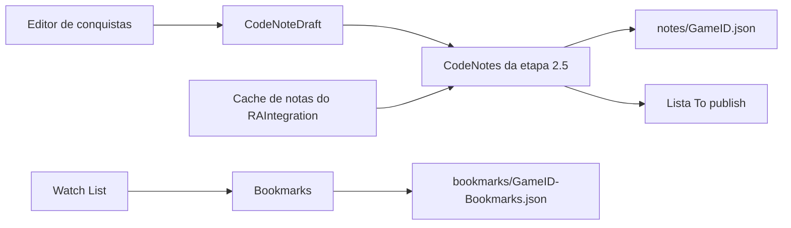

# Etapa 5 — Notas no editor e bookmarks

## Resumo da etapa

**O que a etapa entregou**

A Watch List guarda endereços, nomes e ordem por jogo, com importação/exportação de bookmarks
compatíveis com o RAIntegration. O editor de conquistas mostra as notas dos endereços e permite
criá-las ou editá-las sem sair da condição. As duas interfaces usam os serviços de memória e
notas já existentes. A 5.2 foi validada pelo usuário; a 5.1 foi aprovada para merge após teste parcial, com a confirmação do último
ajuste de layout ainda pendente.

**Mapa do código**

**O caminho de uma edição**

1. O game ID do Status seleciona as notas, independentemente do caminho do arquivo de conquistas.
2. Uma condição fornece o endereço direto do operando. A consulta exata prefere a nota local.
3. Edit note abre um rascunho ligado àquele serviço, sessão, jogo e endereço.
4. Save local note verifica se o contexto e a nota original continuam válidos; então delega a
   gravação ao `CodeNotes`. Falhas mantêm o rascunho aberto.
5. O serviço salva seu JSON local e a lista To publish reflete a diferença em relação ao cache.
   O arquivo de conquistas e o cache do servidor não são destinos dessa gravação.

**Os conceitos mais importantes**

- Game ID como contexto de armazenamento: etapas [2.5](02-memoria.md) e 5.1.
- Fonte local editável versus cache de servidor somente para leitura: 2.5 e 5.1.
- Endereço direto versus offset de ponteiro: 5.1.
- Rascunho, conflito de edição e conservação do texto após falha: 5.1.
- Gravação atômica e proteção de arquivo malformado: 2.5 e 5.2.
- Preservação de campos e formatos de bookmarks desconhecidos: 5.2.

**Lições das revisões**

Um índice ou número isolado não identifica todo o contexto: o mesmo endereço existe em vários
jogos, e o mesmo game ID pode ser recarregado de outro diretório. Campos desconhecidos de
bookmarks precisam sobreviver a edições. Na UI, os widgets precisam de identidade estável,
largura suficiente e uma estratégia de rolagem que não esconda ações.

**Prova da etapa**

1. Por que alterar uma nota não deve mudar `-Notes.json` nem `-User.txt`?
2. Uma condição depois de AddAddress contém `0xH000004`. Por que a nota do endereço absoluto
   `0x000004` não descreve necessariamente essa condição?
3. O que deve acontecer se o usuário mudar o game ID enquanto há um rascunho de nota aberto?
4. Por que importar um bookmark desconhecido não autoriza apagá-lo ao salvar os demais?

## 5.1 — Code notes junto às condições do editor

**O que foi feito**

Os operandos de memória agora exibem Add note ou Edit note abaixo do endereço, seguidos pela
primeira linha da nota. O tooltip contém o texto completo e identifica a fonte local ou o
cache, incluindo o autor quando disponível. A nota local tem prioridade. O editor informa o
game ID das notas, vindo do Status; abrir um `-User.txt` não muda esse contexto silenciosamente.

O popup permite editar uma cópia local e consultar a nota de servidor, somente para leitura.
Save local note usa o mesmo `CodeNotes` da etapa 2.5 e atualiza a lista To publish. Cancel não
grava. Notas podem ser criadas em endereços sem nota anterior, nos dois lados da comparação e
nas abas Core/Alt. Alterar uma nota não modifica a lógica nem marca a conquista como alterada.

Um rascunho aberto impede o encerramento imediato do app. Salvar com sucesso pode continuar a
saída solicitada; uma falha mantém o popup e o texto. Cancel cancela a edição e a tentativa de
saída. O fluxo de alterações pendentes das conquistas continua sendo tratado separadamente.

**Conceitos**

- `achievement_note_address` reconhece Memory, Delta, Prior, BCD e Inverted. A nota pertence ao
  endereço subjacente; valores inteiros, constantes float, Recall e funções não viram endereços
  só porque seu número coincide com uma nota.
- A consulta atual é por endereço exato. Ela não interpreta notas estruturadas, intervalos de
  vários bytes nem cadeias de ponteiros. O operando raiz de AddAddress pode ter nota; a linha
  seguinte é identificada como Indirect offset e não consulta o offset como endereço absoluto.
- `CodeNoteDraft` copia o texto original, o autor/cache e a nota local original. Se a mesma nota
  mudar em outra ferramenta antes de Save, ele recusa sobrescrever e conserva o texto digitado.
  Alterações em outros endereços não criam um conflito.
- `CodeNotes::session_version()` muda a cada load. Mesmo recarregar o mesmo game ID de outro
  diretório invalida um rascunho antigo. A identidade do próprio serviço também é conferida.
- Persistência continua centralizada em `CodeNotes`: o editor novo não cria outro writer nem
  outro formato. As notas usam `notes/<GameID>.json`, e a comparação com o cache é a mesma da 2.5.
- A prévia é limitada sem cortar um caractere UTF-8. As linhas da tabela reservam altura uniforme
  para endereço, botão e prévia, pois `ImGuiListClipper` depende de alturas consistentes.

**Arquivos para ler**

1. `src/devtools/include/cw/devtools/code_note_draft.hpp` e `src/devtools/code_note_draft.cpp`:
   ciclo do rascunho e verificações antes de salvar.
2. `src/devtools/achievement_editor.cpp`: `achievement_note_address` e a exclusão de offsets.
3. `src/devtools/code_notes.cpp`: carregamento por sessão, preferência local, persistência e
   comparação usada por To publish.
4. `src/frontend/achievement_editor_window.cpp`: previews, tooltip, popup, altura do clipper e
   tratamento de saída com um rascunho aberto.
5. `src/frontend/main.cpp`: o editor recebe a mesma instância de `CodeNotes` das outras ferramentas.
6. `tests/test_code_note_draft.cpp`: testes de persistência, conflito, contexto e tipos de operandos.

**O que aprendemos com a referência**

Em `reference/RAIntegration/src/ui/viewmodels/TriggerConditionViewModel.cpp`, os operandos
Address, Delta, Prior, BCD e Inverted consultam notas pelo endereço do memref. As constantes
seguem outro caminho e não são consultas de endereço. `TriggerViewModel.cpp` marca a condição
seguinte a AddAddress como indireta. O código fixado em
`third_party/rcheevos/src/rcheevos/condition.c` também transforma essa leitura usando o contexto
indireto antes de continuar a avaliação.

O RAIntegration resolve ponteiros e notas estruturadas por meio de `IndirectNoteResolver.cpp`.
Nosso `CodeNotes` ainda oferece apenas consultas exatas; portanto, mostrar uma nota do offset
como se fosse a nota do destino seria incorreto. Essa limitação fica visível na interface.
Não acrescentamos gravação no formato `N0:` de `-User.txt`; a decisão da 2.5 de manter notas em
arquivo próprio continua valendo.

**Problemas encontrados**

- **Trocar apenas o game ID não identifica todo o armazenamento:** incluímos uma versão de
  carregamento e a identidade do serviço. Os testes também tentam salvar o rascunho através de
  outro serviço com o mesmo ID e a mesma versão numérica.
- **Uma nota podia mudar enquanto havia um rascunho:** a comparação com a nota local original
  impede sobrescrever a edição mais recente ou recriar uma nota removida por outra ferramenta.
- **Um erro numérico de constante recebia o rótulo Invalid address:** a revisão da Luna pegou
  isso. O ramo de notas agora só trata operandos de memória; o probe de interface verifica
  também uma constante inválida.
- **Prévia de nota longa e UTF-8:** o texto compacto é limitado por bytes com recuo até o início
  do caractere. O probe usa um caractere de dois bytes atravessando o limite da prévia.
- **Células com notas têm mais itens:** a altura mínima uniforme evita que a rolagem do clipper
  calcule a posição das linhas usando só a altura de uma condição sem nota.

**No teste do usuário**

As capturas de 30/10 mostraram a nota `teste 5.1` na lista To publish do jogo 18238, mas a janela
Code Notes cortava campos e colunas quando ficava estreita. O formulário ainda usava rótulos ao
lado dos inputs e um SameLine incondicional para Save path; as tabelas tinham apenas rolagem
vertical, apesar das larguras fixas de endereço, origem e ações.

Os rótulos agora ficam acima dos campos. Save path permanece ao lado somente quando há espaço,
ou passa para a linha seguinte. Instruções, erros e mensagens quebram linha. As tabelas têm
largura mínima proporcional à fonte e rolagem horizontal; endereço, Change e Copy recebem
largura suficiente para seus textos/controles. A coluna de origem limita sua largura ao painel e
quebra nomes longos de autores em linhas. Uma altura mínima mantém a tabela utilizável
quando o formulário cresce, com rolagem vertical da janela quando necessário. A confirmação
manual desse ajuste ainda está pendente; as capturas não validam todos os testes da 4.3–4.4.

Um probe temporário reproduziu o corte na versão anterior e conferiu a função real com notas
sintéticas em 230, 320 e 900 px e fontes 1, 1,5 e 2, nas duas abas. A revisão do coordenador
corrigiu o próprio probe no cenário extremo de 230 px/fonte 2: escrever diretamente no scroll
após Render não estabilizava a posição. Com `SetScrollX/SetScrollY` e frames de atualização, Copy
ficou inteiramente visível sem outra alteração de produção. Build, 219 testes, ASan/UBSan e
formatação passaram. O teste temporário não substitui a conferência do usuário no painel real.

**Verificação e teste manual**

A suíte passou com **219 casos e 9.305 asserções**, sendo 12 casos novos para rascunhos e
endereços de notas. Build, formatação e ASan/UBSan passaram, com LeakSanitizer desativado pela
limitação do ambiente. Os testes conferem persistência após recarregar, Unicode, notas novas,
adoção de nota igual à do cache, conflitos, troca de jogo/diretório, arquivo local malformado,
falha de gravação e preservação dos bytes do cache e do `-User.txt`.

Um probe temporário com cliques e digitação nos widgets reais do ImGui verificou notas nos dois
operandos, nova nota na raiz de ponteiro, Alt, omissão da nota de offset, Cancel, atualização de
To publish, saída adiada, falha de Save sem saída, mudança de game ID, prévia UTF-8 e janela
estreita. O probe também passou com ASan/UBSan. Uma mutação retirou a proteção contra conflito da mesma
nota: o teste falhou com dez asserções, e a suíte completa voltou a passar após restaurar o
código. O teste de interação da 4.4 foi executado de novo
para conferir que as novas células não prejudicam os controles ao vivo.

Quando puder testar:

1. Confira o game ID no Status. Abra um arquivo de conquistas de teste e uma condição com
   endereço conhecido. Verifique a nota logo abaixo do endereço e o tooltip completo.
2. Use Add note/Edit note, digite um texto de teste e Save local note. Em **View → Code Notes →
   To publish**, confira a entrada. Reabra o editor da nota para confirmar o texto.
3. Altere o texto e escolha Cancel: a nota salva deve permanecer igual. Teste também uma nota
   no operando direito e em uma Alt.
4. Durante uma edição, tente fechar o app. Uma falha ao salvar deve manter o rascunho aberto;
   Cancel deve voltar ao app. As alterações da conquista continuam tendo seu próprio fluxo.

Status: 5.1 implementada e aprovada para merge após teste parcial; aguardando confirmação do
ajuste de layout e dos demais cenários.

**Para fixar**

1. Por que uma constante cujo valor é `0x100` não deve mostrar a nota de memória de `0x100`?
2. Por que comparar só o game ID não basta para validar um rascunho?
3. Qual é a diferença entre adotar localmente a nota igual à do cache e escrever uma nota nova
   para a lista To publish?
4. Por que editar uma nota não deve reiniciar o teste ao vivo da conquista?
5. Exercício: acrescente um teste em que uma nota é alterada em outro endereço enquanto o
   rascunho atual está aberto, e explique por que isso não é conflito.

## 5.2 — Bookmarks compatíveis com o RAIntegration

**O que foi feito**

A Watch List agora é carregada por game ID e fica salva em
`$XDG_DATA_HOME/cheevo-workbench/bookmarks/<GameID>-Bookmarks.json`. O JSON segue o formato de
bookmarks do RAIntegration. Adicionar, renomear, reordenar, remover ou mudar entre Decimal e Hex
salva automaticamente no arquivo local, com gravação atômica. A integração continua exibindo
valores ao vivo, mudanças recentes, endereços indisponíveis e code notes.

Os formatos antigos aceitos pelo RAIntegration também são lidos. Entradas com tamanho que a
Watch List não representa e endereços indiretos são preservados no arquivo e identificados como
`unsupported`, sem leitura de valor. Importar de e exportar para `RACache/Bookmarks/` são ações
explícitas; a exportação pede confirmação ao substituir um arquivo. Um JSON local malformado é
mostrado como erro e bloqueia gravações para proteger o original.

**Conceitos**

- O game ID seleciona a lista e o caminho local; trocar de jogo carrega outra lista sem misturar
  os bookmarks.
- RAIntegration grava uma lista na propriedade JSON `Bookmarks`. O formato atual salva endereço
  e tamanho juntos em `MemAddr` (por exemplo, `0xH0d9c24`); `Decimal` só aparece quando ligado e
  `Description` só quando há um nome.
- Os formatos antigos usam `Type` com `Address`, ou `Size` com `Address`. `MemAddr` pode conter
  endereços indiretos que dependem de ponteiros e não podem ser lidos pela Watch List atual.
- Cada mutação escreve primeiro em um arquivo temporário único e o renomeia sobre o arquivo
  local. O RACache é separado e só muda quando o usuário escolhe Export.
- Uma entrada desconhecida mantém seu objeto JSON original. Isso conserva propriedades futuras
  do RAIntegration ao salvar mudanças feitas em outros bookmarks.

**Arquivos para ler**

1. `src/devtools/bookmarks.cpp` — formatos JSON, caminho, preservação e gravação atômica.
2. `src/devtools/include/cw/devtools/bookmarks.hpp` — modelo e operações do serviço.
3. `src/frontend/main.cpp` — troca por game ID, controles da Watch List e importação/exportação.
4. `tests/test_bookmarks.cpp` — dados sintéticos e casos de compatibilidade.

**O que aprendemos com a referência**

`reference/RAIntegration/src/ui/viewmodels/MemoryBookmarksViewModel.cpp` aceita três formas: o
formato atual com `MemAddr`, um formato antigo com `Type` e `Address`, e outro com `Size` e
`Address`. O writer atual usa `MemAddr`, e adiciona `Decimal` e `Description` apenas quando
necessário. O teste do RAIntegration confirma detalhes como o prefixo de tamanho e endereço em
hexadecimal minúsculo. `AchievementLogicSerializer.cpp` escreve tamanhos no prefixo de `MemAddr`;
`FileLocalStorage.cpp` confirma `RACache/Bookmarks/<GameID>-Bookmarks.json`.

O parser usa `rc_parse_memref` do rcheevos fixado em `third_party/rcheevos`, o mesmo parser de
endereços usado pelo RAIntegration através do rcheevos. O formato local é compatível com o cache,
mas mantém os dados do usuário em diretório separado para que a gravação automática não altere o
RACache.

**Problemas encontrados**

- As entradas `Text` e `BitCount` existem no formato antigo, mas não têm uma interpretação
  correspondente na Watch List. Mantê-las como JSON preservado evita perder dados ao editar outra
  linha.
- Um arquivo malformado não pode ser tratado como lista vazia: a próxima edição apagaria os dados
  existentes. A leitura inválida, por isso, desativa gravações até o usuário corrigir o arquivo.
- A forma e a largura dos dígitos de `MemAddr` são parte do formato. Os testes usam um endereço
  compatível com uma memória de PS1 para verificar seis dígitos e prefixo em minúsculo.

**Na revisão**

A preservação inicial cobria somente entradas não suportadas. Editar uma entrada suportada
apagava propriedades desconhecidas dessa entrada e do objeto principal do JSON. Dois testes de
regressão reproduziram a perda antes da correção. Agora normalizamos os campos conhecidos para
`MemAddr`, conservando as extensões tanto nas entradas quanto no documento. Os metadados de uma
importação só substituem os atuais depois de a gravação local terminar com sucesso.

Também verificamos falhas de gravação: se o destino não puder ser substituído, a lista em memória
e seus metadados continuam intactos, e o arquivo temporário é removido. Os testes cobrem os 17
formatos inteiros de `MemAddr` suportados pela Watch List, inclusive os big-endian, e a preservação
de entradas de texto e ponto flutuante como `unsupported`.

O build inicial dos testes encontrou o JSON instalado no sistema, porque faltava declarar a
dependência de `nlohmann_json` no alvo `cw_tests`. Conferir os headers realmente usados pelo
compilador revelou o problema. O vínculo explícito no CMake agora seleciona o submódulo
vendorizado, mesmo em máquinas que também têm uma instalação global da biblioteca.

A validação da revisão terminou com 128 casos e 6.600 verificações passando, build sem warnings
e testes com ASan+UBSan. Duas mutações deliberadas foram detectadas: retirar a proteção contra
gravar sobre JSON inválido e trocar a leitura big-endian por little-endian. O código foi
restaurado depois. LeakSanitizer ficou desativado pela limitação de ptrace do sandbox.

O core PS1 executou 600 frames de Twilight Syndrome em um programa auxiliar, verificando
persistência, ordem, formato, leituras ao vivo, exportação e troca de game ID com dados de teste
em `/tmp`. A aplicação gráfica também iniciou e confirmou o hash e o ID `18238`; os controles
interativos da Watch List ainda dependem do teste manual do usuário.

Uma revisão posterior reproduziu duas falhas na interface: fechar o aplicativo com o campo de
nome ainda ativo perdia a renomeação, e a coluna de ações cortava quase todo o botão `Remove`.
Agora o encerramento salva os nomes pendentes, inclusive com a Watch List oculta ou o aplicativo
minimizado. Se a gravação falhar, o aplicativo permanece aberto, mostra o erro e conserva o
rascunho para uma nova tentativa. A edição continua sendo salva normalmente ao sair do campo.
A largura da coluna `Actions` é calculada pelo texto dos três botões, pelo espaçamento e pela
fonte atual; ela não pode ser reduzida manualmente ou por uma largura antiga salva no layout.

Um programa temporário com ImGui, sem janela gráfica e com dados sintéticos, confirmou as duas
regressões antes da correção. Depois, suas oito verificações passaram, cobrindo também falha de
gravação com a Watch List oculta, preservação do rascunho e nova tentativa de encerramento.

**No teste do usuário**

Up/Down e persistência dos nomes funcionaram, mas o seletor de tamanho ainda deixava o rótulo
`Size` fora de um painel estreito. Ajustar apenas a coluna de ações não resolvia os formulários
acima da tabela. Os campos agora usam a largura disponível e os rótulos ficam acima deles;
tamanho e byte order compartilham uma linha somente quando cabem. Importar/exportar também
mudam de linha, e a tabela tem rolagem horizontal dentro do painel quando necessário. O editor
de valor do Memory Viewer recebeu o mesmo tratamento. Um probe ImGui verificou nove combinações
de largura (320/480/900 px) e escala de fonte (1/1,5/2), sem exigir que a janela fosse ampliada.

O usuário confirmou o funcionamento do layout corrigido na interface real. Up/Down,
persistência dos nomes e os ajustes responsivos estão validados manualmente.

**Para fixar**

1. Por que a Watch List guarda seu arquivo automático fora de `RACache`?
2. O que acontece ao carregar `Size: 14`, e por que esse bookmark não deve ser descartado?
3. Qual é a diferença entre ler `Type: 2` e `Size: 2` nos formatos antigos?
4. Como a gravação temporária seguida de rename evita deixar metade do JSON em caso de falha?
