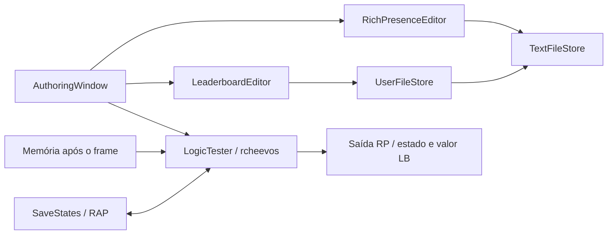

# 06 · Etapa 6: Rich Presence e leaderboards

As duas subetapas estão implementadas e testadas automaticamente. A validação manual com o jogo
continua pendente. As definições e os resultados permanecem locais.

| Subetapa | Conteúdo | Status |
|---|---|---|
| 6.1 | Editor de Rich Presence com prévia ao vivo | 🟡 — aguarda teste manual |
| 6.2 | Editor e teste offline de leaderboards | 🟡 — aguarda teste manual |

## Resumo da etapa

### O que a etapa entregou

O menu View ganhou **Rich Presence** e **Leaderboards**. O primeiro edita scripts locais e mostra
a saída calculada pela memória do jogo. O segundo edita Start/Cancel/Submit/Value, formato,
título, descrição e direção da classificação, e acompanha uma tentativa offline. Os dois usam
o runtime das conquistas e participam do progresso dos save states.

### Mapa do código



### O caminho de um frame

1. O core executa um frame e disponibiliza a memória em endereços RA.
2. O `LogicTester` avalia conquistas, leaderboards e Rich Presence no runtime compartilhado.
3. Os eventos registram início, cancelamento, mudança de valor e conclusão offline do leaderboard.
4. A saída de Rich Presence é calculada e armazenada uma vez nesse fluxo.
5. A UI lê snapshots e texto armazenado. Redesenhar a janela não conta hits nem avança tentativas.
6. Ao carregar um slot, o runtime é reconstruído com as definições atuais; o progresso compatível
   é restaurado após validar o formato. As janelas reencontram os dados pelos IDs.

### Os conceitos mais importantes

- Texto editável, validação e ativação são operações distintas: 6.1–6.2.
- Lookup/Format/Display e condições de exibição: 6.1.
- Gramática de triggers diferente da expressão Value: 6.2.
- Waiting, Active, Started, Canceled e conclusão offline: 6.2.
- Snapshot de arquivo e gravação atômica reutilizável: 6.1.
- Progresso compartilhado e validação dos blocos internos do RAP: 6.2.
- Promoção inteira de bytes antes de deslocar bits: problema encontrado na biblioteca fixada.

### Lições das revisões

O cache de valor do rcheevos não é atualizado no mesmo ramo que emite Submit; o valor final da
expressão deve ser consultado nesse estado. Obter a saída de RP pode avaliar condições sem alvo
de hits, então a UI não deve chamar esse getter durante cada desenho. A gramática completa do
leaderboard e o formato de sua linha no User.txt têm ordens diferentes. O leitor de RAP valida
limites externos, mas alguns leitores internos precisam de proteção adicional no workbench.

### Prova da etapa

1. Por que desenhar o mesmo texto de RP a 144 Hz não pode executar sua lógica a 144 Hz?
2. O que muda entre editar Value e editar a descrição de um leaderboard em teste?
3. Por que comparar um checksum não prova que os blocos internos de um arquivo são válidos?
4. Como uma alteração externa do User.txt é tratada pelo outro editor que já o tinha aberto?
5. Por que uma tentativa concluída nesta ferramenta não aparece no ranking do site?

## 6.1 · Rich Presence local e prévia ao vivo

### O que foi feito

A janela abre ou cria um `-Rich.txt`, mantém um rascunho e valida o texto com o parser fixado do
rcheevos. Erros sintáticos mostram o número da linha informado por ele. Lookup, Format e
Display são avaliados contra memória sintética nos testes e contra a memória do core em uso.

Open/Create, Current game, Save e Reload são explícitos. Current game sugere
`RACache/Data/<GameID>-Rich.txt` quando o RACache está configurado; caso contrário, usa
`$XDG_DATA_HOME/cheevo-workbench/sets/<GameID>-Rich.txt`. Editar o campo de caminho não muda o
arquivo carregado para Save; a janela mostra o caminho efetivamente aberto.

Start preview ativa o rascunho válido para o jogo em execução. Editar o script, trocar o arquivo
ou mudar de sessão do jogo encerra a prévia anterior. Salvar o mesmo script normalizado preserva
seu progresso. Stop preview remove sua definição sem zerar os hits das conquistas nem o estado
dos leaderboards. O texto exibido é limitado a 16 KiB; a UI informa se houve truncamento.

### Conceitos

- **Normalização verificada:** o BOM inicial é removido; todos os bytes CR são retirados; scripts
  não vazios terminam em LF. Texto contendo só espaço em branco vira vazio. Remover um CR isolado
  é o comportamento real do RAIntegration, diferente de convertê-lo para uma nova linha.
- **Limite do script:** 65.535 bytes após normalização. A leitura aceita uma margem limitada para
  BOM/CRLF antes de normalizar, evitando recusar um script normalizado válido no limite.
- **Rascunho inválido continua editável:** abrir um arquivo com erro permite corrigi-lo; Save e
  Start preview ficam bloqueados até ele ser válido. Um script vazio é válido para salvar e
  representar a ausência de presença; não inicia uma prévia.
- **Texto em cache:** `rc_runtime_get_richpresence` pode avaliar displays sem alvo de hits. Ele é
  chamado após o frame emulado; a UI só lê a string guardada no `LogicTester`.
- **Mesmo armazenamento seguro:** `TextFileStore` extrai as operações de I/O já usadas pelo
  `UserFileStore`: leitura limitada de arquivo regular, recusa de symlink final, caminho absoluto,
  temporário irmão, fsync, preservação de permissões, comparação com os bytes carregados e rename.

### Arquivos para ler

1. `src/devtools/rich_presence_editor.cpp` e seu header: normalização, validação e rascunho.
2. `src/devtools/text_file_store.cpp`: armazenamento de texto e proteção de alterações externas.
3. `src/devtools/user_file_store.cpp`: composição do armazenamento comum sem mudar o formato RA.
4. `src/devtools/logic_tester.cpp`: ativação e cache da saída de RP.
5. `src/frontend/authoring_window.cpp`: controles, campos e confirmação de mudanças pendentes.
6. `tests/test_rich_presence_editor.cpp` e `tests/test_authoring_runtime.cpp`: arquivos e frames.

### O que aprendemos com a referência

`reference/RAIntegration/src/devkit/data/models/RichPresenceModel.cpp` confirma o limite,
a remoção de CR, o LF final e a retirada de BOM no carregamento. `FileLocalStorage.cpp` confirma
o caminho em Data. A presença é um arquivo próprio; não é uma linha do User.txt.

`third_party/rcheevos/src/rcheevos/richpresence.c` oferece `rc_richpresence_size_lines` para o
diagnóstico. `runtime.c` atualiza RP no mesmo loop das demais definições. A biblioteca não tem
uma chamada pública de desativação de RP: reconstruímos o runtime e restauramos o progresso das
outras definições, removendo o grafo da presença antiga com segurança.

### Problemas encontrados

- **Macros desconhecidas:** o parser aceita um marcador de macro desconhecida, cujo renderizador
  usa um buffer temporário pequeno. Uma macro desconhecida muito longa poderia causar leitura
  indevida. A validação do workbench também inspeciona os displays compilados e recusa essas
  macros antes de ativar a prévia, mostrando o nome limitado na mensagem de erro.
- **Substituir presença não pode apagar conquistas em teste:** os testes começam com hits e uma
  tentativa ativa, trocam o script e removem RP; ambos os outros estados são conservados.
- **O mesmo ID não identifica todos os arquivos:** o caminho carregado fica fixo. Arquivos
  alterados externamente são preservados, e o rascunho continua disponível após Save falhar.

### Verificação e teste manual

Os testes cobrem BOM/CRLF/CR, espaços, limites, Unicode no texto, sintaxe inválida, macros
conhecidas e desconhecidas, arquivo novo, mudanças externas, falhas de gravação e preservação do
arquivo original. As sequências de memória conferem Lookup, Format, displays condicionais,
Delta/Prior, hits e ausência de avaliações adicionais ao ler a saída.

Quando puder testar:

1. Carregue o jogo e abra **View → Rich Presence**. Use um arquivo de rascunho separado.
2. Abra/crie esse arquivo, digite o exemplo abaixo e clique em Save e Start preview.
3. Com a emulação pausada, avance com N e confira a saída. Editar o script deve parar a prévia.
4. Reload deve recuperar o texto salvo. Com uma edição pendente, Cancel deve conservar o texto;
   Discard deve permitir recuperar o arquivo. Um erro de sintaxe deve impedir Save/Start.

```text
Display:
Memory value: @Number(0xH000010)
```

### Para fixar

1. Qual é a diferença entre salvar o script e ativar sua prévia?
2. Por que BOM/CRLF influenciam o limite em bytes antes da normalização?
3. O que uma janela fechada deve fazer com o rascunho ainda não salvo?
4. Exercício: acrescente uma Lookup com nomes de duas áreas e um display condicional.

## 6.2 · Leaderboards locais e teste offline

### O que foi feito

A janela lista os leaderboards do User.txt e permite adicionar, selecionar, editar e remover
registros. Start, Cancel e Submit usam triggers; Value continua como expressão própria, com
formato e Lower is better separados. Títulos, descrições, IDs e campos desconhecidos não editados
são preservados. O arquivo também conserva conquistas e registros opacos das etapas anteriores.

Start offline test registra a seleção no runtime compartilhado. A janela mostra estado, valor
bruto/formatado, último frame e até 50 eventos recentes. Rearm test limpa a tentativa; Stop test
remove só aquele teste. Mudanças de lógica/formato, seleção, arquivo ou sessão de jogo encerram
o vínculo antigo. Alterar metadados mantém a tentativa. Nenhum resultado é enviado ao site.

### Conceitos

- **Gramáticas diferentes:** `STA`, `CAN` e `SUB` são triggers com condições; `VAL` é uma expressão
  de valor. A definição combinada é validada por `rc_lboard_size`, com limite de 65.535 bytes.
- **Ordem no runtime:** `STA:<start>::SUB:<submit>::CAN:<cancel>::VAL:<value>`. A linha do arquivo
  continua na ordem start, cancel, submit, value, format, title, description e lower-is-better.
- **Waiting:** o início precisa ser falso pelo menos uma vez antes de uma nova tentativa. Em
  Started, Cancel aborta; Submit conclui e calcula o valor final do mesmo frame.
- **Formatação RA:** a UI oferece os nomes reconhecidos pelo parser compilado. Um formato antigo
  desconhecido permanece preservado; ao alterá-lo, é necessário escolher um conhecido. O parser
  usa VALUE como fallback, por isso validar só seu retorno não detectaria um nome digitado errado.
- **IDs temporários:** o ID do teste no runtime é independente do ID do registro local. Eventos
  de leaderboard têm categorias próprias e não aparecem como conquistas disparadas no log antigo.
- **Editores simultâneos:** se Achievement Editor e Leaderboards abrirem o mesmo User.txt e um
  salvar, o outro precisa recarregar esse arquivo antes de salvar novas mudanças. O snapshot
  impede sobrescrever o trabalho mais recente; rascunhos pendentes devem ser preservados ou copiados
  antes de escolher Discard/Reload.

### Arquivos para ler

1. `src/devtools/leaderboard_editor.cpp` e seu header: rascunho textual e documento preservado.
2. `src/devtools/logic_tester.cpp`: registro, estados, formatação, eventos e progresso.
3. `src/frontend/authoring_window.cpp`: seleção, campos, vínculo ao runtime e log.
4. `src/frontend/main.cpp`: uma avaliação por frame e integração com menus, slots e saída.
5. `tests/test_leaderboard_editor.cpp`: preservação, CRUD, formatos e falhas.
6. `tests/test_authoring_runtime.cpp`: sequências de memória e RAP combinado/corrompido.
7. `cmake/ThirdParty.cmake`: correção gerada da leitura sem sinal do progresso no rcheevos fixado.

### O que aprendemos com a referência

`reference/RAIntegration/src/devkit/data/models/LeaderboardModel.cpp` confirma a definição
combinada e os campos locais. `GameAssets.cpp` confirma a linha L em User.txt.
`third_party/rcheevos/src/rcheevos/lboard.c` define a precedência de estados e calcula o valor.
`format.c` confirma os nomes/aliases oferecidos, incluindo formatos de tempo e casas decimais.

`runtime_progress.c` serializa o progresso de triggers, valores de leaderboard e variáveis/displays
de RP. Seu leitor verifica o limite de cada bloco externo, mas faz leituras internas sem verificar
o fim desse bloco. O workbench percorre as estruturas com um cursor limitado antes de chamá-lo.

### Problemas encontrados

- **Placar final diferente do anterior:** o cache do runtime é atualizado em Started/Updated,
  mas não no ramo de Submit. O snapshot de uma tentativa concluída usa o valor da expressão
  calculada no frame final. O teste muda o placar exatamente nesse frame e detectou a falha antes
  da correção.
- **Restauração de outra definição:** blocos com checksum diferente não são interpretados usando
  a estrutura atual. O marcador opcional CWRC conserva o checksum de RP mesmo sem display
  condicional; variáveis/displays de outro script começam sem progresso herdado.
- **Leitores internos sem limites:** a validação confere contadores, hashes pendentes, triggers,
  flags de operandos e valores dentro de ACHV/LBRD/RICH/VARS, inclusive com checksum recalculado
  após corrupção. MREF é retirado quando o destino não tem referências de memória.
- **Estados omitidos pelo writer nativo:** CWLB conserva Inactive/Disabled de leaderboards, como
  CWST já fazia para estados terminais das conquistas. São extensões opcionais RAP que leitores
  padrão ignoram.
- **Deslocamento de inteiro com sinal no rcheevos:** UBSan encontrou o byte alto de um valor RAP
  sendo promovido a `int` antes de `<< 24`. A configuração do CMake gera uma cópia desse arquivo
  com conversões para `uint32_t` antes dos deslocamentos. O submódulo não é editado e a configuração
  recusa aplicar a alteração silenciosamente se o trecho mudar em uma futura atualização.
- **Campo Value consumido só parcialmente:** validar apenas a definição combinada permitiria
  inserir uma cláusula PRO dentro do campo VAL. A ativação também usa agora a validação de valor
  com consumo completo já existente no writer local; o teste reproduziu a aceitação indevida.
- **Registros antigos incompletos:** um leaderboard ainda sem Value não pode iniciar um teste,
  mas, se estiver intocado, não deve impedir selecionar/editar outro registro ou criar um novo.
  O editor distingue o rascunho carregado do texto que o usuário alterou e preserva a linha antiga.
- **Erros nos testes durante a revisão:** um cenário de Rearm dizia que Start estava falso sem
  zerar a memória; outro omitia o prefixo literal Default; e cinco hits eram esperados um frame
  tarde demais. Conferimos os dados e a semântica no parser/avaliador antes de corrigir os testes.

### Verificação e teste manual

A suíte tem **252 casos e 11.779 asserções** passando, incluindo arquivos, runtime e corrupção de
progresso. Build sem warnings e ASan/UBSan passaram após a correção gerada de leitura unsigned.
LeakSanitizer fica desativado pela limitação do ambiente. Um probe temporário com os widgets
reais do ImGui verifica criação/edição, Save/Reload, prévia, início/cancelamento/rearmamento de
leaderboard, mudança de definição/jogo, falha por escrita externa e Save/Discard/Cancel na saída.
O probe também passou com ASan/UBSan. Ele complementa os testes de lógica e não substitui a
confirmação manual com o jogo.

Roteiro para quando puder testar, usando arquivo e slot de teste:

Uma definição de teste que funciona só com constantes, sem alterar memória do jogo:

| Campo | Texto |
|---|---|
| Start | `0=0.2.` |
| Cancel | `0=1` |
| Submit | `0=0.5.` |
| Value | `M:123` |
| Format | `SCORE` |

Pause a emulação antes de Start offline test. Com N fora dos inputs, o primeiro frame deixa o
estado Active, o segundo inicia a tentativa e o quinto conclui com `000123`. Um slot salvo após
o segundo frame deve restaurar Started e o valor 123. Esse roteiro também é verificado em teste
unitário com memória sintética e nenhuma escrita no jogo.


1. Abra **View → Leaderboards** e um User.txt de rascunho. Clique em New leaderboard, preencha
   título/descrição, Start/Cancel/Submit/Value e formato, e use Save/Reload.
2. Clique em Start offline test. Acompanhe estado e valor; pause e avance frames para confirmar
   que a UI parada não avança a tentativa. Teste Cancel e Submit em momentos diferentes.
3. Salve um slot durante Started, avance e carregue o mesmo slot sem mudar a definição. O estado
   e o valor devem voltar ao progresso salvo.
4. Rearm deve reiniciar a tentativa; editar Value ou trocar a seleção deve encerrar o teste antigo.
5. Altere metadados e tente sair. Cancel deve preservar o rascunho. Se Save falhar, o aplicativo
   deve permanecer aberto com o texto disponível.

### Para fixar

1. Por que o valor de Submit pode ser diferente do último evento Updated?
2. Por que VAL não deve ser analisado como se fosse um trigger de conquista?
3. O que precisa ser validado além do tamanho externo e do checksum de um bloco RAP?
4. Qual é a diferença entre um ID de registro local e um ID temporário de teste?
5. Exercício: construa uma sequência sintética que inicia, atualiza, cancela, rearma e conclui
   uma tentativa; indique o estado e o valor esperado a cada frame.


## Revisão adicional de 01/11/2026

A prévia limitada a 16 KiB removia um caractere UTF-8 completo quando ele terminava exatamente
na borda do buffer. A correção só remove sequências cortadas; testes cobrem os dois casos.

`tests/test_authoring_ui.cpp` cria um contexto ImGui sem janela gráfica e simula cliques em Save,
Discard e Cancel. Confere arquivos sintéticos gravados, rascunhos preservados, fechamento do modal
e bloqueio de salvamento de script inválido. Trocar a sessão do jogo conserva os rascunhos.
Esses testes complementam a validação visual com o jogo, que continua pendente.
